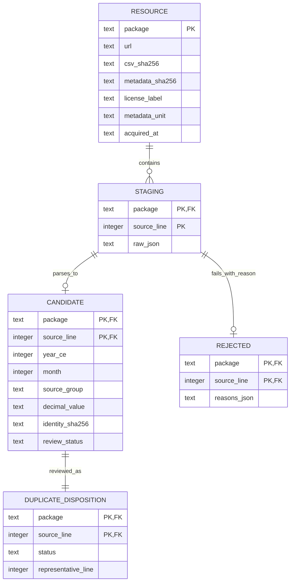

# Relational design — โครงสร้างที่ใช้งานจริงและแบบขยาย

## ระบบปัจจุบัน

แบบจำลองหลายแหล่งที่ใช้งานต่อได้จริงอยู่ [Reusable model v1](reusable-model.md) ใช้นโยบายทีม ไม่รอคำยืนยัน MTEC ส่วนด้านล่างอธิบายฐาน DMF และประวัติการออกแบบตั้งต้น

ชุดเต็มเก็บใน SQLite สำหรับตรวจและ MySQL tamsood_research สำหรับฐานข้อมูลวิจัยแล้ว
MySQL รักษา raw 34,905 แถวและ observation 34,899 แถว พร้อม rejected 6 แถว ดู [แบบจำลอง MySQL ชุดเต็ม](mysql-full.md)
แผนภาพด้านล่างอธิบาย SQLite ที่เป็นขั้น processing ส่วน canonical LCI schema ยังรอการอนุมัติความหมายข้อมูล

การเชื่อม candidate/disposition เป็น 1:1 หลังรัน review สำเร็จ ก่อนรัน review ตาราง disposition ยังไม่มี
staging แต่ละรายการจะอยู่ใน candidate หรือ rejected เพียงทางเดียวตาม pipeline; เป็น invariant ที่ตัวรันตรวจ count ร่วมกับ tests ไม่ใช่ exclusion constraint ใน SQLite
raw_json เป็น source-preserving staging จึงยังมีค่าซ้ำตามต้นทางโดยตั้งใจ

## Keys และ FD ที่รองรับขอบเขตนี้

- resource: package → URL, hashes, metadata ภายในฐานข้อมูลหนึ่ง snapshot run
- staging: (package, source_line) → raw_json
- candidate: (package, source_line) → parsed fields; identity_sha256 เป็น key สำหรับตั้งคำถามเรื่อง duplicates ไม่ใช่ UNIQUE constraint
- duplicate_disposition: (package, source_line) → status, representative_line
- source_group ไม่เป็น global unique key และชื่อแปลงไม่ใช้สร้าง geographic identity ข้าม source โดยอัตโนมัติ

PK/FK ที่ชี้ staging ทำให้เก็บ observation และเหตุ reject กลับถึงข้อมูลต้นทางได้
view traceable_candidate join ด้วย PK จึงไม่เพิ่มแถว; pipeline ตรวจ row counts และ foreign keys หลังรัน
amount เป็นข้อความ decimal ใน SQLite เพื่อเลี่ยง binary float; จะเลือก precision/scale สำหรับ MySQL จากข้อมูลจริงและทดสอบก่อน migrate
ค่าที่พบปัจจุบันใช้ทศนิยมสูงสุด 10 ตำแหน่ง การใช้ DECIMAL(20,6) ของ pilot สามรายการจึงไม่พอสำหรับ CSV ทั้งชุด

## แบบขยายสำหรับ canonical database รอบถัดไป

เพิ่ม SOURCE/PUBLISHER, RESOURCE_VERSION/SNAPSHOT, PRODUCTION_CONTEXT, PRODUCT/FLOW,
MEASUREMENT, SOURCE_REFERENCE และ QUALITY_CHECK โดยอิง FD/semantics ของ source จริง
ไม่เปลี่ยนชื่อ production observation เป็น LCI_EXCHANGE เพียงเพื่อให้เหมือนตัวอย่างในคู่มือ
ต้องมี process boundary/direction/reference basis ที่รองรับก่อน map เป็น exchange
การตัดสินใจนี้รอ domain review; provenance และ raw snapshot สามารถใช้ต่อได้ทันที

## Normalization reasoning

แยก resource metadata ออกจากแถวข้อมูลเพื่อไม่ต้องแก้ URL/หน่วย/สิทธิในทุกแถว
แยกผล duplicate review เพื่อ re-run กฎโดยไม่แก้ข้อมูลดิบ
raw_value กับ decimal_value เป็น redundancy ที่ตั้งใจใช้ตรวจ parser ไม่ใช่การอ้างว่าฐานข้อมูลผ่าน 3NF ทุก relation
dictionary, FD จาก business rules, lossless join และ dependency preservation ต้องตรวจอีกครั้งเมื่อ freeze canonical schema
