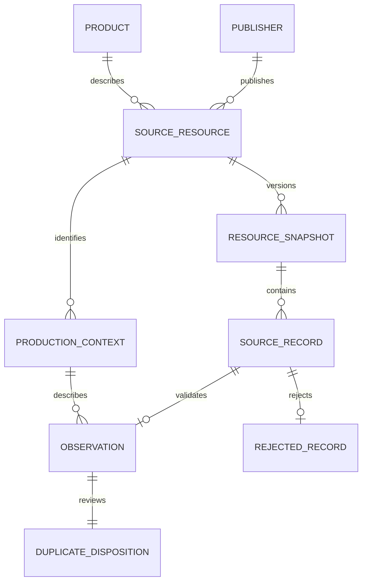

# MySQL ชุดเต็ม: ฐานข้อมูลวิจัยที่ตรวจย้อนกลับได้

สถานะ 22 ตุลาคม 2569: โหลด raw 34,905 แถว, observation 34,899 แถว, rejected 6 แถว และ deduplicated pending 34,671 แถวแล้ว Accepted สำหรับการแข่งขันยังเป็น 0

## ใช้งาน

```powershell
python -X utf8 scripts/run_pipeline.py --mysql
python -X utf8 scripts/mysql_workspace.py status
python -X utf8 scripts/mysql_workspace.py stop
```

ต้องมี Docker ทำงานและ image mysql:8.1 ในเครื่อง คำสั่งไม่ดึง image ใหม่เอง ฐานชื่อ tamsood_research อยู่ใน container tamsoodbase-mysql ใช้ volume tamsoodbase-mysql-data การ stop เก็บข้อมูลไว้ ไม่มีพอร์ตที่เผยแพร่ รหัสผ่านอยู่ .local/mysql-workspace.json และถูก gitignore อย่าแนบไฟล์นี้ในรายงานหรือ repository

การโหลดซ้ำแทนเฉพาะ snapshot ที่ hash ตรงกันภายใน transaction ไม่เพิ่มแถวซ้ำ Snapshot รุ่นอื่นคงอยู่ จึงต้องกรอง snapshot เมื่อต้องการนับข้อมูลแข่งขันข้ามรุ่น ห้ามนับ observation เดียวกันจากหลายรุ่นซ้ำ

## แบบจำลองและเหตุผล



| ตาราง / field สำคัญ | ความหมายและกฎ |
|---|---|
| resource_snapshot.snapshot_id CHAR(64) | hash ของ package + CSV hash + metadata hash จึงเปลี่ยนเมื่อบริบท metadata เปลี่ยน |
| resource_snapshot.metadata_json JSON | คำอธิบายต้นฉบับ รวมหน่วย ตัวคูณ และสิทธิใช้ข้อมูล |
| source_record(snapshot_id, source_line) | PK ระบุตำแหน่ง CSV; raw_json รักษาค่าทุกช่องและ record_content_sha256 ใช้ตรวจเนื้อหา |
| production_context.context_id | hash ของ package/พื้นที่/แปลง/กลุ่มแหล่ง ตามคำต้นฉบับ ยังไม่รวมชื่อข้ามแหล่งโดยเดา |
| observation.period_start DATE | วันแรกของเดือน Gregorian หลังแปลง พ.ศ.; มี CHECK วันต้องเป็น 1 |
| observation.amount DECIMAL(30,12) | ทศนิยมแม่นตรง ไม่ผ่าน float; exporter ปฏิเสธ overflow หรือค่าที่ต้องปัดเศษ |
| observation.raw_value VARCHAR(100) | ตัวอักษรตัวเลขเดิม รวม trailing zeros เมื่อมี |
| observation.production_days TINYINT | อยู่ระหว่าง 0 กับจำนวนวันจริงของเดือน |
| observation.review_status | บังคับ PENDING สำหรับ schema รุ่นนี้; ไม่มีเส้นทาง promote อัตโนมัติ |
| observation.unit_time_basis | บังคับ UNCONFIRMED จนมีหลักฐานเรื่องฐานเวลาย้อนหลัง |
| duplicate_disposition | SINGLETON / EXACT_REPRESENTATIVE / EXCLUDE_EXACT_COPY / HOLD_CONFLICT พร้อม FK แถวตัวแทน |
| rejected_record.reasons_json | เหตุผลไม่ผ่าน เชื่อมกลับ raw เดิมได้ |

หน่วยและตัวคูณเก็บตาม snapshot เช่น ล้านลูกบาศก์ฟุต ยังไม่คูณหรือแปลงเป็นต่อวันโดยอาศัยตัวอย่างรายงานเพียงเดือนเดียว ไม่มีการรวม amount ข้ามเดือนหรือผลิตภัณฑ์

PK/FK แยกหลักฐานจากค่าที่ตรวจแล้ว ช่วยป้องกัน orphan records และลด metadata ซ้ำ Index ix_period_context รองรับการค้นช่วงเดือนและบริบท ผล EXPLAIN ถูกเก็บในการตรวจ MySQL จริง

## หลักฐานตรวจ

รัน `python -X utf8 scripts/verify_full_mysql.py` เพื่อสร้าง container ชั่วคราวของการทดสอบ ตรวจแล้วลบเฉพาะ container/volume ของรอบนั้น ไม่แตะฐานถาวร

- เทียบ Decimal 34,899 ค่าและ duplicate disposition กลับ SQLite
- เทียบ raw JSON 34,905 แถวกลับ staging ซึ่ง exporter ตรวจกลับ CSV และ hash แล้ว
- import สองรอบ จำนวนแถวคงเดิม
- ทดสอบการปฏิเสธค่าติดลบ วันผลิตผิด สถานะ ACCEPTED ที่ยังไม่อนุมัติ ฐานเวลาที่เดา PK ซ้ำ และ FK ที่ไม่มีจริง

ผลอยู่ evidence/full-mysql-verification-2026-10-22.json การตรวจนี้พิสูจน์การจัดเก็บและ mapping ไม่ใช่การยืนยันความถูกต้องของสถิติต้นทางทั้งชุด

ตัวอย่าง query อยู่ sql/mysql/full-queries.sql ส่วน sql/mysql/schema.sql และ docs/mysql-pilot.md เป็น pilot รุ่นก่อน ไม่ใช้แทนชุดเต็ม

## ข้อจำกัดที่ต้องปิดก่อนส่งแข่ง

ต้องยืนยัน LCI eligibility และฐานเวลา ตรวจค่าและบริบทจากหลักฐานที่เป็นอิสระเพิ่ม และทบทวน 93 กลุ่มที่พักไว้ พบ 72 กลุ่มมีวันผลิตรวมเท่าปฏิทินและ 21 กลุ่มเกินเดือน แต่ยังไม่มีหลักฐานวันเริ่ม–สิ้นสุดหรือ denominator จึงไม่รวมค่าหรือเลือกแถวใดเอง
