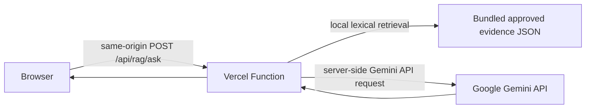

# Public RAG web readiness

**Status checked:** 9 November 2026 (Asia/Bangkok)
**Release decision:** HOLD for Production. A limited, non-production Vercel Preview mode is prepared for a live Gemini integration check; it is not deployed or cleared for general public use.

## Architecture prepared

The function does not call EC2, Qdrant, or a private gateway. In Preview mode it ranks only six attributed narrative records derived from the CC BY 4.0 Permpool et al. article, sends the question and matched evidence to Gemini after the user checks the consent box, and returns an answer with source IDs and attribution. If retrieval finds no evidence, it abstains without contacting Gemini. Gemini credentials are read only from the Function's server environment; the browser bundle does not receive the key. The Production RAG corpus remains blocked by its manifest. The existing EC2 key file does not automatically become a Vercel secret.

`api/rag/ask.js` validates same-origin HTTPS, request type/size, question length, explicit Gemini consent, and a strict source-ID response contract. It has a request deadline, generic upstream errors, and a per-instance Preview limit. That in-memory limit is not durable or global. Production needs a Vercel WAF rate-limit rule and Gemini quota/budget controls, evidenced before enabling the public route.

## Verified current state

| Area | Evidence | Status |
|---|---|---|
| Vercel-native API | `api/rag/ask.js` | Implemented locally; no deployment made |
| Production retrieval corpus | `docs/rag/public-evidence.json`, `docs/rag/statistical-facts.json` | 8 narrative cards and 10 facts; rights and external LLM use remain blocked |
| Preview retrieval corpus | `docs/rag/vercel-preview-corpus.json` | Six attributed narrative records from one CC BY 4.0 article; no facts or other sources |
| Rights | `docs/rag/public-release-manifest.json` | All current records remain `PENDING`; public release false |
| External model | Current manifest disallows external LLM; no live request from Vercel | Blocked pending rights and privacy review |
| Gemini key | Previously placed on EC2 by the user | Not present in Vercel; must be added separately as a server-side secret after approval |
| Retrieval/answer quality | `evidence/rag-public-user-eval-2026-11-09.json` | 28 assistant-authored retrieval cases; no independent user acceptance and no generated-answer evaluation |
| Rate limit and cost | No durable per-user/global limiter evidence | Release blocker |
| Production site | Production build/runtime flags and manifest | Closed; no public route enabled |
| Current deployment | Vercel deployment `9wDqMfCgp` from `main` | Ready, but GET `/ask.html` and `/api/rag/ask` both return 404; feature code is still local |

## Release gates

Do not flip manifest booleans or environment flags to bypass these items:

1. **Rights and corpus:** clear redistribution and attribution for every card/fact, or remove records that cannot be cleared. Record reviewer, source locator, decision, and date. Keep private raw source files out of the Function bundle.
2. **External model/privacy:** explicitly approve sending user questions and matched excerpts to Google. With unpaid Gemini API quota, Google states it may use prompts/responses to improve products and human reviewers may process them. Do not submit sensitive, confidential, or personal data. Billing status can change the applicable terms; review the actual project configuration and current terms before release. See [Gemini API terms](https://ai.google.dev/gemini-api/terms) and [pricing/data-use table](https://ai.google.dev/gemini-api/docs/pricing).
3. **Abuse and spend:** deploy and verify real rate limiting at the ingress, define a global request/token budget and Gemini project quotas, set alerts, and identify the owner. The Function currently has no shared counter; an in-memory limit would not be reliable across serverless instances.
4. **Quality:** add independent Thai questions, unsupported and conflicting-evidence cases, and evaluate generated answers, numeric grounding, citations, and abstention. Obtain member review. The existing retrieval benchmark does not qualify generated answers.
5. **Capacity and monitoring:** measure function duration, Gemini timeouts, concurrent traffic, errors, quota exhaustion, and alerting under the actual Hobby configuration. Set an acceptable traffic limit.
6. **Retention and privacy:** publish final data handling, processor, log, retention/deletion, and contact details. Verify the Vercel and Google settings, including whether the Gemini project is using paid or unpaid services.
7. **Rollback and acceptance:** identify a rollback owner, capture the exact deployment and environment references without recording secret values, test rollback, and exercise the public page, citations, invalid origin, malformed request, timeout, rate limits, privacy notice, and mobile layout.

## Configuration after gates pass

The static page stays closed unless the build uses `TAMSOOD_PUBLIC_RAG_ENABLED=true` and the manifest validates. The Function separately requires:

- `TAMSOOD_RAG_PUBLIC_ENABLED=true`
- `GEMINI_API_KEY` (server-side Vercel environment variable; never `NEXT_PUBLIC_*` or a browser variable)
- `TAMSOOD_GEMINI_DATA_PROCESSING_ACCEPTED=true`
- `TAMSOOD_RAG_PUBLIC_ORIGIN` (exact HTTPS origin)
- `TAMSOOD_RAG_RIGHTS_CLEARANCE_REF`
- `TAMSOOD_RAG_RATE_LIMIT_POLICY_ID` (reference to an actually deployed limiter)
- `TAMSOOD_RAG_PRIVACY_REVIEW_REF`
- `TAMSOOD_RAG_UAT_REF`

The build and runtime also require the machine-readable manifest to approve all corpus records, external Gemini processing, and the Vercel-applicable release gates. Private-network and EC2 server-token settings are not part of this architecture. Add `GEMINI_API_KEY` only in the Vercel project's **Settings → Environment Variables**, scoped to the intended environment, after privacy approval. The key currently stored on EC2 must be copied by the user through the secret-entry UI or a new key generated; it is not read or transferred by this code.

## Limited live Preview check

The Preview path is separate from Production. It uses only `vercel-preview-corpus.json` and requires `VERCEL_ENV=preview`, `TAMSOOD_RAG_PREVIEW_ENABLED=true`, `TAMSOOD_GEMINI_DATA_PROCESSING_ACCEPTED=true`, `GEMINI_API_KEY`, and the preview deployment URL. At build time it also needs `TAMSOOD_PUBLIC_RAG_PREVIEW_ENABLED=true`. Environment variables are scoped separately: the key saved for Production is unavailable to Preview, so the user must add the same key again under Preview. The page requests consent for every question. Its in-memory rate limit is defense in depth only; configure Vercel deployment protection and/or WAF limiting before sharing the Preview URL widely.

## Limits of this implementation

The lexical ranking is a lightweight serverless substitute for the existing Qdrant hybrid retrieval and does not inherit its quality scores. The generated-answer contract checks shape and citation IDs but cannot prove semantic entailment. The Preview mode is only for a limited integration check; the Production feature must stay closed until the blockers above have evidence and the deployed endpoint passes acceptance.
