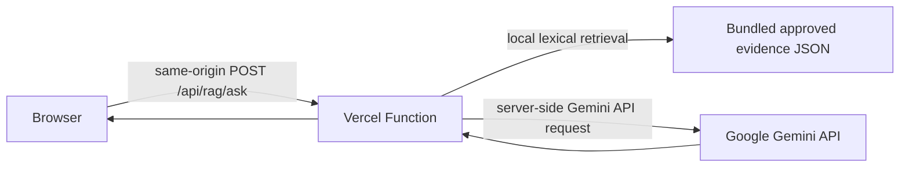

## DMF freshness review — 10 November 2026
A new isolated fetch of all three official CKAN CSV resources produced byte-identical files to the current local snapshot; each still ends at exact period 2026-03. The DMF monthly-report page lists reports through September 2569 (September page updated 19 October 2569), so the CKAN exports and monthly-report page must be treated as distinct source paths until their relationship, units, and periods are verified. An earlier comparison of independent `MAX(year)` and `MAX(month)` values incorrectly suggested a future December row; exact `(year, month)` grouping corrected that inference, and no future-period rows were found. Candidate rows remain `PENDING`; this fetch changed no canonical data, MySQL, search index, or public corpus. Evidence: `evidence/dmf-refresh-check-2026-11-10.json`. The focused database-index/catalog/scope suite passed (24 tests); `node tests/rag-vercel-api.cjs` passed with the public route closed.

# Public RAG web readiness

**Status checked:** 10 November 2026 (Asia/Bangkok)
**Release decision:** HOLD for public RAG/data access. A P0 proxy lockdown was deployed to the Production alias on 10 November 2026 and verified anonymously. Dataset/login APIs now return 403 with zero rows; the static site and safe health/release metadata remain available. Production RAG and database-backed user access are still closed.

**Launch-gate contract:** `docs/rag/required-release-gates.json` is the shared list used by the RAG runtime, production frontend build, and catalog release predicate. Each path rejects a manifest with a missing/extra gate or any gate not set to `true`. The manifest currently declares all nine gates as `false`; this contract does not grant clearance. See `evidence/rag-launch-gate-parity-review-2026-11-12.json`.

## Production API disclosure and local lockdown — 10 November 2026

An anonymous read-only probe of `https://tamsoodbase.vercel.app` returned HTTP 200 for dataset APIs, including DMF `PENDING`, NSO with unconfirmed reuse scope, EPPO with unverified redistribution terms, product inventory, and reference metadata marked `NOT_CLEARED`. Only counts/statuses were recorded in `evidence/production-anonymous-api-exposure-2026-11-10.json`; no row values were saved.

The local Vercel proxy now returns HTTP 403 for all dataset/login routes before opening an upstream connection. A Preview deployment was checked first: all 15 routes returned 403 when reached via authenticated Vercel CLI, while anonymous Preview access was stopped by Deployment Protection. The Production hotfix was then deployed to `https://tamsoodbase.vercel.app`. Anonymous post-deploy probes confirmed all 15 routes return 403 with zero rows; `/`, `/ask.html`, `/api/healthz`, and `/api/release` remain available. A POST to `/api/rag/ask` returned 503 before calling Gemini. Evidence: `evidence/production-dataset-api-hotfix-2026-11-10.json`. This closes the anonymous disclosure; it does not add user authentication or clear any dataset rights. Do not treat the Vercel-to-backend service credential or Preview Deployment Protection as end-user authentication.

## Recheck — 10 November 2026

### Live backend connectivity probe — 10 November 2026

A fresh read-only probe found Production `/api/healthz` and `/api/readyz` both return HTTP 200 through the existing Vercel server-side backend proxy; `/api/records` remains HTTP 403. Production `/api/rag/ask` returns 503 on POST, while `/api/rag/search` and `/api/rag/query` return 404. On EC2, `tamsoodbase-api` and MySQL are healthy, the MySQL account used by the API has only `SELECT`/`USAGE` grants, and the current database release is `9f6475ffbbe1ccbfcdb724d764bbc70d01c0190ee9155268909b9fcf92c705ea`. The RAG container is healthy but remains on a separate internal Docker network from the API/MySQL, with no host ports. No row values were captured. Evidence: `evidence/rag-live-backend-connectivity-2026-11-10.json`.

The live database status aggregates show DMF 34,899 rows are `PENDING`; NSO 273 and EPPO 5,934 rows are `STAGED_SOURCE_VERIFIED`; research inventory 16 rows are `SOURCE_REPORTED_PRODUCT_INVENTORY`; and 97 corporate records accepted for internal reference still do not establish publication rights (the two documents report reuse as unconfirmed). These statuses are not publication clearance, so the fixed-query service must currently return no dataset rows.

This confirms the existing authenticated Vercel-to-backend health path; it does **not** mean RAG can search the database. There is still no `/api/rag/search` or fixed-query endpoint, no RAG-to-API/MySQL network path, and no cross-layer rights ledger that could safely authorize records. Public dataset routes remain closed and Gemini receives no database content.

The user resumed RAG work. `docs/rag/dataset-catalog-map.json` now documents the five database layers (DMF, company reports, NSO, research, EPPO) and their current schema/table mapping; supporting methodology/context references are identified as non-domain tables. `scripts/build_rag_catalog.py` builds an ignored local catalog/index from `docs/source-registry.csv`, `public-evidence.json`, `statistical-facts.json`, and the limited Preview corpus. It preserves source IDs, record IDs, source URLs/locators, status, rights, unit, scope, measurement period, and publication-year hints separately; missing fields remain `null`. The local builder currently indexes 22 source-registry rows, 20 curated narrative/fact records, and 6 Preview article cards. Its Production/public-cleared output contains 0 records because neither the current manifest nor source rights rows clear those records. The index is a JSON prototype, not a full-text PDF or live database index.

Production RAG and numeric SQL are still not ready. `api/rag/ask.js` serves the 6-record Preview corpus and calls Gemini directly from the Vercel Function; it does not authenticate to or query the EC2 RAG service. Existing `api/[route].js` has a server-only Basic Auth proxy and its health path is live, but no approved `/api/rag/query` or search route exists. EC2 RAG has no host port and remains isolated from the API/MySQL Docker network; only its private SSH tunnel is intended for direct testing. Do not route Vercel to MySQL or expose the EC2 container. Numerical aggregation must remain unavailable until a backend implements fixed query IDs with validated parameters, rights/status predicates, a read-only DB principal, a RAG-specific authenticated HTTPS route, and tests proving that no arbitrary SQL can be submitted. Until then, numeric questions without an exact approved fact should abstain instead of asking Gemini to sum.

The current catalog builder and private SQLite FTS5 index remain local-only: 41,017 search documents across DMF, company, NSO, EPPO, research, and supporting layers are all locked to `release_allowed=0` and `external_llm_allowed=0`, and the index is not connected to Vercel, EC2, MySQL, or Gemini. Its source-time fields preserve their documented meanings; file mtimes are not treated as freshness evidence. On 10 November, the only Production change was the Vercel proxy lockdown: no EC2 change, RAG release flag change, database connection, or rights decision occurred. Preview Deployment Protection and browser Origin checks are not Production user authentication. Remaining human/external gates include source redistribution review, external Gemini/privacy approval, durable ingress rate/cost controls, independent user evaluation, capacity/monitoring, and a reviewed rollback/acceptance record.

The deployed Vercel handler classifies quantity/total/count/average questions as structured numeric requests and contains a no-Gemini unavailable response because no fixed SQL backend exists. Local route tests cover numeric abstention and server-side consent enforcement; Production currently stops at the global release gate with HTTP 503, so those answer branches are not live-accepted. Latest local verification: Python suite 306 run / 296 passed / 10 skipped; all 17 CJS test files passed; frontend build and Vercel source-package checks passed; catalog/index output remains public/external-LLM closed; and post-deploy anonymous Production probes pass. These results do not constitute live RAG or user-authenticated data acceptance. Evidence: `evidence/project-final-review-2026-11-10.json` and `evidence/production-dataset-api-hotfix-2026-11-10.json`.

Follow-up copy fix — numeric abstention now explains in plain Thai that this chat cannot yet combine numbers while checking units, period, and source, instead of requiring the user to understand SQL/API terminology. Regression assertions verify that numeric questions still return no evidence citations and do not call Gemini. Focused route tests pass; Production `/api/rag/ask` remains closed with HTTP 503 before Gemini. No database-backed numeric service was deployed.

## Architecture prepared

The function does not call EC2, Qdrant, or a private gateway. In Preview mode it ranks only six attributed narrative records derived from the CC BY 4.0 Permpool et al. article, sends the question and matched evidence to Gemini after the user checks the consent box, and returns an answer with source IDs and attribution. If retrieval finds no evidence, it abstains without contacting Gemini. Gemini credentials are read only from the Function's server environment; the browser bundle does not receive the key. The Production RAG corpus remains blocked by its manifest. The existing EC2 key file does not automatically become a Vercel secret.

`api/rag/ask.js` validates same-origin HTTPS, request type/size, question length, explicit Gemini consent, and a strict source-ID response contract. Per-request bounds are 2 KiB for the incoming body, 500 characters for the question, at most four retrieved evidence cards, 700 generated output tokens, a 48 KiB model response, and an 18-second upstream deadline. The Preview also has a per-instance limit. Targeted regression checks cover these bounds; the in-memory limit is not durable or global. Production still needs a verified ingress limiter, Gemini project quotas/budget alerts, and a named owner before enabling the public route.

Google's Gemini safety guidance separately recommends limiting query volume and protecting against prompt injection; these are recommendations, not evidence that a shared limiter is deployed in this project: [Gemini API safety guidance](https://ai.google.dev/gemini-api/docs/safety-guidance).

### Vercel ingress limit candidate — 10 November 2026

Current official Vercel documentation says WAF rate limiting is available on all plans, with fixed-window rules and IP/JA4 keys on Hobby and Pro. Counters are regional, not a hard global budget. The published rate-limit price is $0.50 per million allowed requests; the plan table lists one million included requests for Hobby and usage-based charging for Pro, so the actual project plan and billing must be checked before enabling. No WAF rule was configured for TamsoodBase. The owner-facing, non-executed setup and verification steps are in [VERCEL_RATE_LIMITER_RUNBOOK.md](VERCEL_RATE_LIMITER_RUNBOOK.md); configuration is an immediate Production firewall change and remains a human action. This rule would add ingress throttling only; it would not close the remaining rights, privacy, global budget, UAT, capacity, or rollback gates. Sources: [WAF Rate Limiting](https://vercel.com/docs/vercel-firewall/vercel-waf/rate-limiting), [Usage and Pricing](https://vercel.com/docs/vercel-firewall/vercel-waf/usage-and-pricing), [WAF overview and rollback](https://vercel.com/docs/vercel-firewall/vercel-waf).

## Verified current state

| Area | Evidence | Status |
|---|---|---|
| Vercel-native API | `api/rag/ask.js` | Deployed in the 10 Nov hotfix; Production release gate returns 503 before Gemini |
| Production retrieval corpus | `docs/rag/public-evidence.json`, `docs/rag/statistical-facts.json` | 10 narrative cards and 10 facts; rights and external LLM use remain blocked |
| Preview retrieval corpus | `docs/rag/vercel-preview-corpus.json` | Six attributed narrative records from one CC BY 4.0 article; no facts or other sources |
| Rights | `docs/rag/public-release-manifest.json` | All current records remain `PENDING`; public release false |
| External model | `docs/rag/PUBLIC_WEB_READINESS.md`, Preview smoke record 9 Nov | One consented Preview request was verified; this is not Production privacy approval or independent answer evaluation |
| Gemini key | Preview smoke record 9 Nov | A Preview key was used then; its current value is not inspected or recorded. Production key/configuration is not attested |
| Retrieval/answer quality | `evidence/rag-public-user-eval-2026-11-09.json`, `evidence/rag-prompt-injection-contract-2026-11-10.json` | Assistant-authored retrieval/contract tests exist; no independent Thai acceptance or generated-answer adversarial evaluation |
| Per-request cost bounds | `api/rag/ask.js`, `tests/rag-vercel-api.cjs` | Body/question/context/output/response/deadline bounds have focused regression coverage; these do not impose a total spend ceiling |
| Durable rate limit and global cost | No durable per-user/global limiter evidence | Release blocker |
| Production site | Production build/runtime flags and manifest | Closed; no public route enabled |
| Current deployment | `https://tamsoodbase.vercel.app` | Production hotfix active; public site works, dataset APIs return 403, RAG POST returns 503; no database-backed user access |

## Release gates

Do not flip manifest booleans or environment flags to bypass these items:

1. **Rights and corpus:** clear redistribution and attribution for every card/fact, or remove records that cannot be cleared. Record reviewer, source locator, decision, and date. Keep private raw source files out of the Function bundle.
2. **External model/privacy:** explicitly approve sending user questions and matched excerpts to Google. With unpaid Gemini API quota, Google states it may use prompts/responses to improve products and human reviewers may process them. Do not submit sensitive, confidential, or personal data. Billing status can change the applicable terms; review the actual project configuration and current terms before release. See [Gemini API terms](https://ai.google.dev/gemini-api/terms) and [pricing/data-use table](https://ai.google.dev/gemini-api/docs/pricing).
3. **Abuse and spend:** deploy and verify real rate limiting at the ingress, define a global request/token budget and Gemini project quotas, set alerts, and identify the owner. The Function currently has no shared counter; an in-memory limit would not be reliable across serverless instances.
4. **Quality:** add independent Thai questions, unsupported and conflicting-evidence cases, and evaluate generated answers, numeric grounding, citations, and abstention. Obtain member review. The existing retrieval benchmark does not qualify generated answers.
5. **Capacity and monitoring:** measure function duration, Gemini timeouts, concurrent traffic, errors, quota exhaustion, and alerting under the actual Hobby configuration. Set an acceptable traffic limit.
6. **Retention and privacy:** publish final data handling, processor, log, retention/deletion, and contact details. Verify the Vercel and Google settings, including whether the Gemini project is using paid or unpaid services.
7. **Rollback and acceptance:** identify a rollback owner, capture the exact deployment and environment references without recording secret values, test rollback, and exercise the public page, citations, invalid origin, malformed request, timeout, rate limits, privacy notice, and mobile layout.

## Configuration after gates pass

The static page stays closed unless the build uses `TAMSOOD_PUBLIC_RAG_ENABLED=true` and the manifest validates. The Function separately requires:

- `TAMSOOD_RAG_PUBLIC_ENABLED=true`
- `GEMINI_API_KEY` (server-side Vercel environment variable; never `NEXT_PUBLIC_*` or a browser variable)
- `TAMSOOD_GEMINI_DATA_PROCESSING_ACCEPTED=true`
- `TAMSOOD_GEMINI_AUDIENCE_ELIGIBILITY_CONFIRMED=true` (owner has verified intended user ages and regions against the current Gemini API terms)
- `TAMSOOD_RAG_PUBLIC_ORIGIN` (exact HTTPS origin)
- `TAMSOOD_RAG_RIGHTS_CLEARANCE_REF`
- `TAMSOOD_RAG_RATE_LIMIT_POLICY_ID` (reference to an actually deployed limiter)
- `TAMSOOD_RAG_PRIVACY_REVIEW_REF`
- `TAMSOOD_RAG_UAT_REF`

The build and runtime also require the machine-readable manifest to approve all corpus records, external Gemini processing, and the Vercel-applicable release gates. Private-network and EC2 server-token settings are not part of this architecture. Add `GEMINI_API_KEY` only in the Vercel project's **Settings → Environment Variables**, scoped to the intended environment, after privacy approval. The key currently stored on EC2 must be copied by the user through the secret-entry UI or a new key generated; it is not read or transferred by this code.

## Limited live Preview check

The Preview path is separate from Production. It uses only `vercel-preview-corpus.json` and requires `VERCEL_ENV=preview`, `TAMSOOD_RAG_PREVIEW_ENABLED=true`, `TAMSOOD_GEMINI_DATA_PROCESSING_ACCEPTED=true`, `TAMSOOD_GEMINI_AUDIENCE_ELIGIBILITY_CONFIRMED=true`, `GEMINI_API_KEY`, and the preview deployment URL. The audience flag must be set only after the owner verifies intended user ages and regions against current provider terms; it does not provide age or geolocation enforcement. At build time it also needs `TAMSOOD_PUBLIC_RAG_PREVIEW_ENABLED=true`. Environment variables are scoped separately: the key saved for Production is unavailable to Preview, so the user must add the same key again under Preview. The page requests consent for every question. Its in-memory rate limit is defense in depth only; configure Vercel deployment protection and/or WAF limiting before sharing the Preview URL widely.

## Limits of this implementation

The lexical ranking is a lightweight serverless substitute for the existing Qdrant hybrid retrieval and does not inherit its quality scores. The generated-answer contract checks shape and citation IDs but cannot prove semantic entailment. The Preview mode is only for a limited integration check; the Production feature must stay closed until the blockers above have evidence and the deployed endpoint passes acceptance.

## Preview verification update — 9 November 2026
A Vercel Preview deployment is now READY after the user added `GEMINI_API_KEY` to the Preview environment and redeployed. Deployment `dpl_7TB8sJAU88SUhu2iLsWdhdHfkYb5` (commit `d057e07`) was checked through the UI. A consented live question, “CO₂e คิดยังไง?”, returned a grounded Gemini response referencing `fame-allocation-caution`, DOI 10.3390/su12229415, Section 3.1.4 / PDF page 7, and CC BY 4.0. The response states the source does not detail a CO₂e calculation method and reports economic allocation of 70% FAME / 30% crude glycerin, matching the bundled corpus. Preview UI now accurately identifies the limited preview mode. Targeted route checks and 14 frontend tests pass. This was one integration smoke test, not independent user evaluation. Preview is Vercel-authenticated; Production remains on HOLD and was not promoted.

## UI entry-point and chatbot update — 9 November 2026
The homepage and main navigation now link to `/ask.html`; the RAG page has a home link, character counter, expanding textarea, Ctrl+Enter shortcut, and an ARIA conversation log. The local frontend build succeeded with RAG closed. Commit `1702590` is pushed to `codex/rag-gemini-preview-2026-11-09`. As checked in Vercel, no deployment for this commit was visible yet; the latest visible Preview was still `dpl_7TB8sJAU88SUhu2iLsWdhdHfkYb5` at `d057e07`. Production remains on old `main` (`aff41e1`) and public RAG stays closed. PR #1 was closed because targeting the stale main would include about 593 changed files. Next: deploy and inspect the Preview commit, then reconcile the correct production branch without bypassing any RAG release gates.
## Deployment check — 9 November 2026
The homepage/chat entry-point UI changes in commit `1702590` are pushed but are not yet deployed. At 22:58 Asia/Bangkok, the Vercel Preview URL still served the earlier revision, so its homepage had no RAG navigation entry. Project Settings → Git says no repository is connected; local Vercel credentials are absent. The local frontend build succeeds with RAG closed. Before reviewing the new UI in a hosted Preview, the user must authorize either connecting the GitHub repository to Vercel (new repository access) or a CLI authentication flow. Production RAG remains closed and the production site was not changed.

## Hosted Preview check after schema fix — 9 November 2026
User approved connecting only `Neroadawat/TamsoodBase` to the Vercel project. The repository is connected; unsupported `public` property removed from `vercel.json` in commit `b5b53cf`. Vercel Preview deployment `dpl_BauBwNZFV1BqVRfk2z1kemNRVFLA` is Ready. Hosted home page visibly links to `/ask.html`; the link works, and one consented Gemini smoke-test query returned an answer with its DOI, section/page, and CC BY 4.0 attribution. This is a single integration test, not independent user acceptance. Production remains unchanged and RAG remains closed there. Future repository changes can trigger Vercel deployments through the connected Git integration.

## Repository review follow-up — 9 November 2026
The local Vercel RAG gate now returns closed immediately whenever `VERCEL_ENV=preview` and the explicit preview flag is absent; it cannot fall through to the Production gate. Regression assertion added. Verification after the change: all 290 Python tests pass (10 skipped), all 17 CJS test files pass, and `git diff --check` passes. The working-tree change has not been pushed or deployed, so the existing Preview does not yet contain it. No Production deployment or EC2 change was made. The requested formal Codex Security scan failed to start in the desktop security-scan runtime and produced no scan report; manual source review is not a substitute for that audit.
Follow-up hardening bounds the Preview instance-local IP bucket map to 2,048 entries, rejects oversized forwarded-address values, and prunes expired entries when full. Regression checks cover the cap and expiry cleanup. This is memory protection only; it is not a distributed rate limiter or a Production abuse-control gate.
The release gate also rejects any Vercel environment other than `production` or an explicitly enabled `preview`, preventing development/local deployments from falling through to the Production gate.
## Corpus overview query fix — 9 November 2026
Questions such as “what can you do?” and “what data is in the system?” are answered from a deterministic catalog of the six records in the limited Preview corpus, with source links. They previously hit the scope-anchor abstention before reaching Gemini. Preview quick prompts now match that corpus instead of advertising E10/TSM topics that are not present in it. Route-level test confirms six cited records and no Gemini call for the overview response. This does not add any corpus records and does not change Production release gates.
The chatbot consent text now distinguishes deterministic corpus-overview replies (not sent to Gemini) from evidence questions that send the question and matched excerpts to Gemini.
## Live Preview verification — 9 November 2026
Commit `7539147` is Ready as Preview deployment `7BaDSeCKYL7vDFweUpgD8rqjTqjd` at https://tamsoodbase-neyr5o5v6-neroadawats-projects.vercel.app/ask.html. Browser testing of “แชตนี้มีข้อมูลเรื่องอะไรบ้าง?” and “แชตนี้ทำอะไรได้บ้าง” returned the six corpus entries and their source locators. These catalog questions are answered locally by the function without calling Gemini. The deployment remains a limited, Vercel-protected Preview; Production was not changed.

## Targeted credential scan — 10 November 2026
A value-free pattern scan covered 782 text files under application source, docs, tests, and config. It found no Google AIza, AQ-prefixed, or literal Gemini/Google API-key assignment patterns in that scope. `.env.local` exists at the repository root, was not read, is ignored by `.gitignore` (`.env*`), and is not tracked by Git. The scan excludes raw snapshots, build/tmp/output artifacts, dependencies, and Git history; it is not a complete secret audit. It does not invalidate the need to rotate any key previously pasted into chat. Evidence: `evidence/rag-readiness-review-2026-11-10.json` (`credential_scan`).

## Release-index gate hardening — 10 November 2026

The catalog generator now fails closed unless the global manifest status and all mandatory release gates are approved, in addition to record and source rights. Regression coverage deliberately marks record/source rights cleared while leaving the global manifest on hold; the generated public index remains empty. Verification: full Python suite 296 passed/10 skipped; all 17 CJS files passed; focused frontend/catalog tests 20 passed; Vercel RAG API contract passed; frontend build succeeded with `publicRagEnabled=false`, `ragMode=closed`, and no private research data; catalog check reports 20 private sources, 20 restricted evidence records, and 0 public records. No deployment, rights change, or database access occurred. Evidence: `evidence/rag-release-gate-hardening-2026-11-10.json`.

The source DDL review also confirms that the current tables do not provide normalized clearance for every layer: the company `document.rights_status` exists, while DMF/NSO/research/EPPO retain status and/or descriptive metadata without a queryable `CLEARED` decision. This is why no aggregate SQL endpoint was added: it would need a source/record rights registry joined into the served database before it can enforce the release policy. Exact layer-by-layer field notes are in `docs/rag/dataset-catalog-map.json` and `evidence/rag-rights-schema-audit-2026-11-10.json`. The full Python suite was rerun after the mapping assertion change: 296 passed/10 skipped.

## DMF monthly report intake and cross-representation check — 10 November 2026

Official HTML and Excel exports for March and September 2569 were acquired as isolated candidates under ignored `tmp/`; report hashes and structural/numeric checks are recorded in `evidence/dmf-monthly-candidate-2026-11-10.json`. March's CKAN snapshot and the official monthly Excel report cover 34 area/source-group records; 170 numeric fields are within the report's displayed 0.01 precision and production-day counts agree. Two oil/gas records retain a punctuation-only block-label difference (`14A16A` versus `14A-16A`); this is explicitly held without normalization. This same-publisher representation comparison is not independent measurement validation. The September Excel has 33 detail rows, report revision 19 October, explicit daily-rate units, field/block labels and worksheet-row locators; it is newer than CKAN's March 2026 snapshot.

Both monthly sources have been added to the private source registry as `acquired_pending_review` / `NOT_CLEARED`. The 41,017-row FTS index now finds the September report internally; public and external-LLM queries still return zero. The raw workbook was not imported into canonical databases or sent to Gemini. CKAN's `Open Data Common` label conflicts with `isopen=false`; the official publication page's public access statement does not by itself clear redistribution rights for this project.

## Numeric token grounding guard — 10 November 2026
The local Gemini response parser now rejects digit tokens in an answer unless the normalized value appears in the cited evidence text. It handles Thai digits, comma grouping, and decimal display forms without converting tokens to floating-point. A regression test confirms two distinct integers above JavaScript's safe precision limit do not compare equal after rounding. This is a lexical guard only: it does not prove that a matching number describes the same metric, unit, period, or relationship, and it does not detect number words. No live Gemini call or deployment was made; independent answer evaluation remains required.

### Unitless numeric answer follow-up — 12 November 2026

A targeted review reproduced that an answer could repeat a source's value while omitting its unit (for example, answering `7` when the cited text says `7 t CO2e/year`). The parser now rejects that ambiguous form when the cited evidence contains a unit-bearing measurement for the same value; a matching value and supported unit still passes. `node tests/rag-vercel-api.cjs` passes with the new regression. This remains lexical matching, not semantic entailment or unit conversion; no live Gemini call or deployment was made, and independent Thai answer evaluation remains required. Evidence: `evidence/rag-unitless-numeric-answer-guard-2026-11-12.json`.

## RAG launch-gate parity audit — 12 November 2026

The manifest declares nine launch gates. A review found that both the Production API and public-build guard had required only seven; `private_network_connectivity_verified` and `server_to_server_auth_configured` could be false while those two code paths otherwise accepted a manifest. Both guards now require all nine declared gates. Regression checks passed for the runtime and a production-build fixture. The current checked-in manifest still sets every gate to false and remains `HOLD_RIGHTS_REVIEW`; no value was approved or changed. If either gate is not applicable to an architecture, revise the gate contract with explicit scope and evidence rather than silently ignoring it. Evidence: `evidence/rag-launch-gate-parity-review-2026-11-12.json`.

### Grounding-failure response copy — 12 November 2026

A rejected numeric answer is now returned as a no-answer/abstention state with a Thai explanation and no citations attached to the rejected answer; retrieved source cards remain inspectable. Only `ungrounded_numeric_claim` uses this path; transport/model failures remain service errors. Mocked route, static UI-contract, and build-copy checks passed. No live Gemini call or deployment; browser visual and independent user evaluation remain open. Evidence: `evidence/rag-grounding-abstention-ux-2026-11-12.json`.
