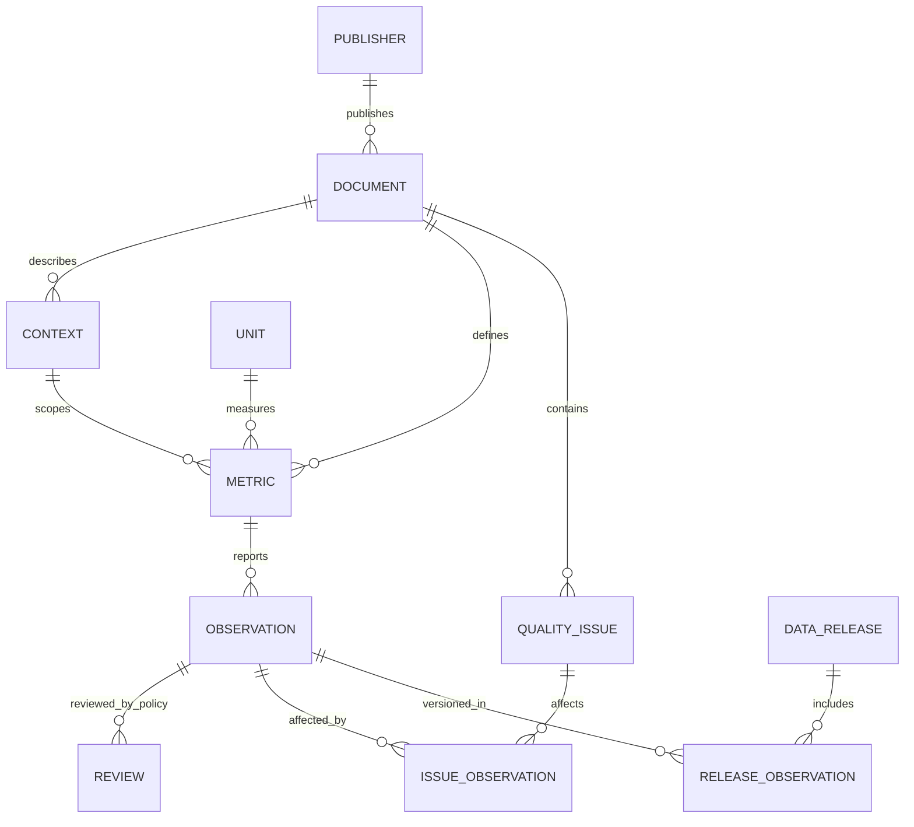

# แบบจำลองข้อมูลอ้างอิงพร้อมใช้ v1

ใช้ [นโยบายทีม](team-data-policy.md) เป็น business rules ไม่รอคำยืนยันภายนอก การรับข้อมูลคือ ACCEPTED_REFERENCE ภายใต้ LOCAL_RESEARCH_REFERENCE แยกจาก normalized LCI exchanges

## โครงสร้างที่สร้างและใช้งานจริง



MySQL database: tamsood_reusable; SQLite: build/reusable/reference.sqlite ทั้งสองใช้เอนทิตีและ identity เดียวกัน MySQL เก็บ scaled_amount/scale_factor เป็น DECIMAL(30,12) ส่วน SQLite เป็น decimal string เพื่อไม่ให้เกิด binary float

## Dictionary และ FD สำคัญ

| Relation / identity | Fields และความหมาย |
|---|---|
| publisher: publisher_id | รหัส/ชื่อผู้เผยแพร่ |
| document: document_id | PDF SHA256 → publisher, title, report_year, URL, accessed_at, rights_status |
| unit: unit_code | หน่วย → dimension; m3 กับ m3/year แยกกัน |
| context: context_id | document + source scope + boundary note → geographic-status และคำอธิบายขอบเขต |
| metric: metric_key | เอกสาร + source metric + mapping semantics → label/context/unit/kind/aggregation_role |
| observation: observation_id | metric/year/source value/locator → raw string, factor, scaled decimal, source page/line; UNIQUE(metric_key,reference_year) |
| review: (observation_id, policy_version) | decision, actor และวิธีตรวจ; ไม่สร้างชื่อผู้ตรวจมนุษย์ |
| quality_issue: issue_id | เอกสาร + source issue → เหตุผลที่พักบริบท |
| issue_observation: (issue_id, observation_id) | แถวที่เกี่ยวข้องกับ issue; ไม่เลือกแถวที่ถูกเอง |
| data_release: release_id | เวอร์ชันที่ผูกนโยบาย schema และ source artifacts |
| release_observation: (release_id, observation_id) | สมาชิกของชุดที่เผยแพร่ภายในแต่ละรุ่น |

Context FK เป็นคู่ (context_id,document_id) เพื่อห้าม metric อ้างขอบเขตคนละเอกสาร Source metric ID เดียวกันไม่ถูกใช้เป็น global canonical flow ID เพราะชื่อเหมือนกันอาจมีความหมายต่างกัน

## เหตุผล normalization และข้อยกเว้น

แยก metadata ระดับเอกสาร หน่วย ขอบเขต ตัวชี้วัด และ review policy ออกจาก observation ลด update anomalies โดยไม่แก้ URL/ขอบเขตในทุกปี Join ผ่าน PK/FK และ UNIQUE(metric,year) ไม่เพิ่ม observation โดยไม่ตั้งใจ

raw_value กับ scaled_amount เป็น redundancy ที่ตั้งใจเก็บเพื่อ audit การคำนวณ ไม่อ้างว่า relation ที่มี derived value นี้เป็น 3NF บริสุทธิ์ทุก attribute การเปลี่ยน source/mapping สร้าง content identity ใหม่และคงข้อมูลรุ่นก่อน ไม่แก้ facts เดิมเงียบ ๆ การทดสอบตรวจ raw × factor = scaled_amount และ MySQL roundtrip

Review แยกตาม policy_version ทำให้ release เก่าไม่ถูกตัดสินใหม่โดยนโยบายปัจจุบัน View reference_catalog รวมทุก release จึงต้องกรอง release_id เสมอ API และ export ใช้รุ่นปัจจุบันจาก manifest เท่านั้น

policy_version เป็น fingerprint ของรุ่นนโยบายร่วมกับ source artifacts/schema/implementation ของ release; policy_sha256 เก็บ hash ของข้อความนโยบายโดยตรง เพื่อไม่ให้หลักฐานหรือ implementation ที่เปลี่ยนไปเขียนทับผล review เก่า

## ประเภทและ aggregation semantics

data_kind แยก ORGANIZATION_INPUT, ORGANIZATION_OUTPUT, REPORTED_INTENSITY, CONTEXT_METRIC; aggregation_role แยก TOTAL/COMPONENT/MEASURE/INTENSITY/CONTEXT ตัวเลขที่อยู่ในฐานเดียวกันไม่ได้แปลว่าบวกรวมกันได้

ค่า source unit ที่เป็น Million GJ ปรับตัวคูณเป็น GJ อย่างตรงไปตรงมา แต่ไม่มีการหารด้วยผลิตภัณฑ์ การเปลี่ยนลูกบาศก์ฟุตเป็น kg หรือการปันส่วนที่ไม่ได้รายงาน

## Mapping ที่ใช้จริง

| Source field | Canonical field | Rule |
|---|---|---|
| source PDF hash | document.document_id | ตรวจ exact bytes ก่อนสกัดซ้ำ |
| source label / metric ID | metric.label/source_metric_id | คงนิยามแหล่ง ไม่รวมข้ามผู้เผยแพร่ |
| boundary + note | context | คง scope ตามเอกสาร ไม่อ้างโรงกลั่นล้วนถ้าขอบเขตองค์กรกว้างกว่า |
| year column | observation.reference_year | เลือกตำแหน่งปีจากตารางที่ตรวจแล้ว |
| raw value | observation.raw_value | คง comma และ trailing zeros |
| unit multiplier | scale_factor/scaled_amount | Decimal exact; ปฏิเสธ overflow/rounding |
| source direction / semantic classification | metric.data_kind | intensity/context แยกจาก input/output |
| open context issue | review.decision | HOLD_CONTEXT พร้อม junction อ้างสมาชิกทุกแถว |
| complete evidence without open context issue | review.decision | ACCEPTED_REFERENCE ตามนโยบายทีม |

## ใช้งาน

```powershell
python -X utf8 scripts/run_reference.py --mysql
python -X utf8 scripts/package_reference.py
python -X utf8 examples/use_reference.py build/reusable/accepted-reference.json --year 2024
```

run_reference ทำงาน offline จาก raw snapshots ที่มีอยู่ เลือก Python ที่มี pypdf หรือใช้ bundled runtime ที่พบในเครื่อง หากไม่มีให้ติดตั้ง requirements-report.txt ใน environment ที่เลือก หรือระบุ --pdf-python PATH

API: /api/reference, /api/reference.csv, /api/reference.json กรอง publisher/year/data_kind/decision ได้ ค่าเริ่มต้นตัด HOLD_CONTEXT และเก็บสถานะสิทธิ/usage profile ทุกแถว SQL ตัวอย่างอยู่ sql/mysql/reusable-queries.sql

แพ็กเกจ build/reusable/reference-data-local.zip มี CSV/JSON ชุดรับแล้ว, SQLite/MySQL load script ที่รักษารายการพักไว้, policy, schema, query, ตัวอย่าง Python และ manifest ที่ตรวจ hash แล้ว ไม่มี raw PDF และไม่อ้างสิทธิแจกจ่ายต่อ

CSV/JSON ในแพ็กเกจและ records ใน API ใช้ชื่อ field เดียวกัน เช่น reference_year, source_metric_id, decision, scaled_amount, unit_code และ source_scope ตัว JSON API ห่อ rows ด้วย manifest/pagination ส่วนไฟล์ JSON ในแพ็กเกจเป็น array เพื่ออ่านง่าย ตัวเลขปริมาณเป็น decimal string; ปี/เลขหน้าเป็น integer

## ตรวจการนำไปใช้ต่อโดยแยกจาก repo

รัน `python -X utf8 scripts/verify_reference_package.py --mysql` เพื่อแตกแพ็กเกจในโฟลเดอร์ชั่วคราว ตรวจ hash และ SQLite แล้วรันตัวอย่าง Python ด้วย isolated mode (-I) โดยใช้ standard library เท่านั้น จากนั้นนำ SQL เข้า database ว่างชื่อเฉพาะรอบสองครั้ง เทียบ accepted records ทุกค่า หน่วย สถานะ และ locator แล้วลบเฉพาะ database ที่รอบนั้นสร้างสำเร็จ

ผลจริงอยู่ evidence/reference-package-verification.json: source records 101, accepted 97; ไม่ใช่การอ้างว่าทดสอบบน OS/เครื่องอื่นทั้งเครื่อง
