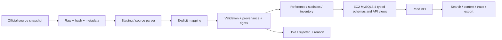

# Software Requirements Specification
# TamsoodBase — Petroleum, Natural Gas & Fuels

CN230 × MTEC · ฉบับร่างเพื่อให้ทีมตรวจ · Version 0.7.2 · 10 พฤศจิกายน 2569

**ไม่ใช่ฉบับส่งแล้ว:** รหัสทีม/section/รายชื่อ/บทบาท/ผู้รับรอง: **รอสมาชิกกรอกข้อมูลจริง** ไม่ถือผู้ช่วย AI เป็นสมาชิกหรือผู้ลงนาม รายงานนี้อธิบายระบบที่มีหลักฐานปัจจุบัน ไม่รับรอง MTEC acceptance

| รุ่น | วันที่ | การเปลี่ยนแปลง | สถานะการทบทวน |
|---|---|---|---|
| 0.7.2 | 2026-11-10 | แยก architecture ของ RAG จาก dataset API; เพิ่มข้อกำหนด privacy/provider eligibility และสถานะ release gate จากโค้ด/evidence ล่าสุด | AI-assisted technical draft; รอสมาชิกตรวจทานและยืนยัน audience |
| 0.7.1 | 2026-11-05 | ยืนยันAPIโมเดล/metadataบนVercel และMySQLcandidate8.4.13ที่ทดสอบแยกแล้ว;เพิ่มสถานะส่งมอบจริง | ไม่มีproductionDBmigrationหรือscientificcertification |
| 0.7 | 2026-11-05 | เพิ่ม activity model store, sealed release, source/provider invariants, evidence-bound decisions, public metadata profile, B100 API และขอบเขต local/live | AI-assisted technical draft; scientific/team review ยังไม่ครบ |
| 0.6 | 2026-10-30 | เพิ่มรหัสอ้างอิง SRC-01–SRC-10 พร้อม mapping ไปยัง source IDs ใน registry; รวม NSO tables ตามสิ่งพิมพ์และลงทะเบียน MDPI Tables 1–3 | AI-assisted draft; รอสมาชิกทบทวน |
| 0.5 | 2026-10-29 | ปรับบท Introduction ตามโครงตัวอย่าง: วัตถุประสงค์ ขอบเขต นิยาม Functional Unit/System Boundary และอ้างอิง source IDs จาก registry | AI-assisted draft; รอสมาชิกทบทวน |
| 0.1 | 2026-10-27 | รวมข้อกำหนด การออกแบบ การสร้าง และหลักฐานจาก repo; AI-assisted draft | รอสมาชิกทบทวนและรับรอง |
| 0.4 | 2026-10-28 | เพิ่มimports2024อีก10ค่าตรง;18derived ratiosผ่าน;คง23yearconflict/2dashไว้hold | รอสมาชิกทบทวน |
| 0.3 | 2026-10-28 | เพิ่มprimary-supply2024อีก14comparisons;รวม169/273;รักษาroundingแยกexact | รอสมาชิกทบทวน |
| 0.2 | 2026-10-28 | อัปเดต MySQL EC2/Vercel, restore จริง, Neo4j จริง และผลตรวจข้อมูล พร้อม use cases/acceptance ที่ละเอียดขึ้น | AI-assisted technical draft; รอสมาชิกทบทวน |

## 1. Introduction

โครงเอกสาร: บท1–8เป็นข้อกำหนดและหลักฐานพื้นฐาน;บท9อธิบายโมเดล/API/สิทธิและข้อจำกัดรุ่น0.7;ภาคผนวกมีแผนภาพschemaเดิมและactivity model local ใหม่

สถานะรุ่น0.7: ส่วนเดิมอธิบายระบบตามรอบตรวจเดิม ส่วนเพิ่มเติมท้ายเล่มเป็นข้อกำหนดและการแก้ล่าสุด ต้องอ่าน local/candidate/live แยกกัน ไม่ใช้วันเอกสารรับรองว่าขึ้นproductionแล้ว ดู docs/CURRENT_ARCHITECTURE.md และส่วน9 ด้านล่าง

### 1.1 Purpose · วัตถุประสงค์

เอกสาร Software Requirements Specification (SRS) ฉบับนี้กำหนดวัตถุประสงค์ ขอบเขต นิยาม และแหล่งข้อมูลอ้างอิงของ TamsoodBase เพื่อให้สมาชิกทีมพัฒนาฐานข้อมูลและส่วนค้นข้อมูลบนข้อกำหนดที่ตรวจสอบย้อนกลับได้ เอกสารนี้ใช้สื่อสารกับสมาชิกทีม ผู้สอน และผู้ทบทวนทางเทคนิค โดยเชื่อมความต้องการกับแบบจำลองข้อมูล SQL การตรวจสอบคุณภาพ และหลักฐานการทำงาน

ปัญหาที่ระบบมุ่งแก้คือข้อมูลด้านปิโตรเลียม ก๊าซธรรมชาติ และเชื้อเพลิงของไทยกระจายอยู่ในชุดข้อมูลทางราชการ รายงานองค์กร และงานวิจัย ค่าที่กล่าวถึงเรื่องใกล้กันอาจอ้างคนละหน่วย ช่วงเวลา พื้นที่ กระบวนการ ตัวหาร หรือขอบเขตการรายงาน หากรวมโดยไม่บันทึกบริบท ผู้ใช้อาจเทียบค่าที่ไม่เทียบกัน หรือเข้าใจสถิติการผลิต/การใช้ว่าเป็นข้อมูลวัฏจักรชีวิตต่อผลิตภัณฑ์

TamsoodBase จึงจัดเก็บและเปิดค้นข้อมูลโดยคงค่าจากแหล่ง ที่มาของแต่ละระเบียน ตำแหน่งใน snapshot สถานะการตรวจ และข้อจำกัดการใช้ เพื่อให้ผู้ใช้ตรวจบริบทก่อนนำข้อมูลไปวิเคราะห์หรือพิจารณาสร้าง inventory ต่อ เอกสารนี้เป็นร่างทางเทคนิคจากระบบและหลักฐานที่มี ณ วันที่ระบุ ยังรอสมาชิกตรวจและรับรอง และไม่ใช่การรับรองจากผู้สอนหรือ MTEC

### 1.2 Scope · ขอบเขต

**Domain.** ระบบครอบคลุมข้อมูลปิโตรเลียม ก๊าซธรรมชาติ และเชื้อเพลิงที่เกี่ยวข้องกับประเทศไทย โดยแยกข้อมูลตามความหมายและขอบเขตของแหล่ง ไม่รวมข้อมูลต่างระดับเป็นชุดเดียวเพียงเพราะชื่อผลิตภัณฑ์คล้ายกัน

**ข้อมูลและกระบวนการที่อยู่ในขอบเขตปัจจุบัน.** ระบบมีข้อมูลห้าชั้น ได้แก่ (1) บริบทการผลิตรายเดือนจากกรมเชื้อเพลิงธรรมชาติ (DMF) (2) ตัวชี้วัดด้านสิ่งแวดล้อม/พลังงานที่รายงานโดย Thai Oil และ SPRC (3) สถิติพลังงานระดับประเทศจากสำนักงานสถิติแห่งชาติ (NSO) (4) สถิติการใช้น้ำมันในการกลั่นและการผลิตน้ำมันสำเร็จรูปจาก EPPO/DOEB และ (5) รายการ foreground inventory ของ FAME/H-FAME ที่รายงานในงานวิจัย ระบบรองรับการค้น ดูรายละเอียด provenance กรอง และส่งออกตามชนิดข้อมูลและสถานะที่มีหลักฐาน

**นอกขอบเขต.** รุ่นนี้ไม่อ้างว่าเป็นบัญชี LCI ของอุตสาหกรรมปิโตรเลียมไทยครบวงจร ไม่สร้าง process ที่ไม่มีหลักฐาน ไม่แปลงยอดบริษัทหรือสถิติประเทศเป็น exchange ต่อผลิตภัณฑ์โดยอัตโนมัติ ไม่คำนวณ refinery yield จากข้อมูลที่มีฐานและขอบเขตไม่ตรงกัน ไม่เติม allocation หรือปีข้อมูลที่แหล่งไม่ได้ระบุ และไม่ทำ Life Cycle Impact Assessment (LCIA) การเป็นข้อมูลอ้างอิงที่ทีมรับไว้ไม่ทำให้ข้อมูลนั้นกลายเป็น normalized product LCI หรือได้รับสิทธิแจกจ่ายต่อโดยอัตโนมัติ

**Functional Unit และ System Boundary.** ระบบนี้เป็นฐานข้อมูลหลายแหล่ง มิได้กำหนด Functional Unit เดียวสำหรับทุกระเบียนหรือทุกชั้นข้อมูล สถิติจาก DMF, NSO, EPPO และรายงานองค์กรคงหน่วย ช่วงเวลา พื้นที่ และขอบเขตการรายงานตามต้นฉบับ ส่วนรายการ FAME/H-FAME คง reference basis ที่รายงานในงานวิจัย ซึ่งระบุฐาน 1,000 MJ ของเชื้อเพลิง ระบบยังไม่กำหนด product system boundary แบบ cradle-to-gate หรือ cradle-to-grave ให้ข้อมูลทั้งหมด ดังนั้นการเปรียบเทียบหรือคำนวณต่อทำได้เฉพาะเมื่อมีหลักฐานว่าหน่วยอ้างอิงและ boundary เข้ากัน

### 1.3 Definitions · คำนิยาม

| คำศัพท์ | นิยามที่ใช้ในเอกสารนี้ |
|---|---|
| Process | กิจกรรมหรือหน่วยกระบวนการที่แหล่งข้อมูลระบุและมีขอบเขตพอให้แยกจากกิจกรรมอื่นได้ การมีสถิติระดับองค์กรหรือประเทศไม่ทำให้เกิด process ระดับผลิตภัณฑ์ขึ้นเอง |
| Flow | สาร พลังงาน หรือบริการที่เข้า/ออกจาก process ตามนิยามและหน่วยของชุดข้อมูล ใน SRS นี้ยังคงชื่อและบริบทจากแหล่งเมื่อการจัดประเภทเป็น flow กลางยังไม่มีหลักฐานพอ |
| LCI Exchange | ระเบียนปริมาณ input หรือ output ที่เชื่อมกับ process, flow, หน่วย, ทิศทาง และ reference basis/boundary พร้อมแหล่งที่มา ค่า source-reported exchange ไม่ได้แปลว่าผ่านการ normalize หรือเป็น LCI ที่ทีมรับรองแล้ว |
| Functional Unit (FU) | หน่วยเชิงปริมาณที่กำหนดบริการหรือผลผลิตซึ่งใช้เป็นฐานอ้างอิงสำหรับวิเคราะห์/เปรียบเทียบ LCI ต้องมีนิยามและหลักฐานจากระบบผลิตภัณฑ์ที่ศึกษา; TamsoodBase ไม่กำหนด FU ร่วมให้ทุกชุด |
| System Boundary | ขอบเขตกระบวนการและช่วงวัฏจักรชีวิตที่รวมไว้ในการศึกษา เช่น cradle-to-gate เมื่อระบุไว้โดยแหล่งหรือการศึกษาที่มีหลักฐาน ไม่อนุมาน boundary จากชื่อผลิตภัณฑ์หรือหน่วยเพียงอย่างเดียว |
| Provenance | ข้อมูลที่ใช้ตามรอยระเบียนถึงแหล่งและ snapshot ที่ตรวจได้ เช่น source ID, hash, locator (หน้า/ตาราง/แถว/คอลัมน์) และวิธีได้มาหรือแปลงค่า |
| ACCEPTED_REFERENCE | สถานะที่ทีมใช้ระบุว่ารับข้อมูลเป็นข้อเท็จจริงอ้างอิงภายในตามนโยบายทีม ไม่ได้หมายถึง accepted normalized LCI, การยืนยันความถูกต้องทางวิทยาศาสตร์ทั้งหมด หรือการอนุญาตเผยแพร่ซ้ำ |
| HOLD_CONTEXT | สถานะพักข้อมูลที่ยังเก็บหลักฐานไว้ แต่ไม่นำเข้า default reference export จนกว่าบริบทหรือข้อขัดแย้งสำคัญจะได้รับการทบทวน |
| Data period / Publication year | Data period คือช่วงเวลาที่ค่ารายงานอ้างถึง ส่วน publication year คือปีเผยแพร่เอกสาร; ไม่ใช้ปีเผยแพร่แทนปีของข้อมูลหากไม่มีหลักฐาน |

### 1.4 References · แหล่งอ้างอิงข้อมูล (Source IDs)

รหัส `SRC-xx` ใช้เรียกแหล่งอ้างอิงในเล่มและบนเว็บไซต์ ส่วน `source_id` ใช้ระบุชุดข้อมูล/รายการทางเทคนิคใน [source registry](../source-registry.csv) หนึ่งแหล่งตีพิมพ์อาจเชื่อมกับหลาย `source_id` ได้ การมีรหัสอ้างอิงหรือ URL ไม่ใช่การรับรองความถูกต้องหรือการอนุญาตแจกจ่ายข้อมูล

| รหัสอ้างอิง | แหล่งข้อมูลและตำแหน่งที่ใช้ | `source_id` ใน registry | URL / สถานะและข้อจำกัด |
|---|---|---|---|
| SRC-01 | กรมเชื้อเพลิงธรรมชาติ — ปริมาณการผลิตน้ำมันดิบ | `DMF-CKAN-OIL` | [ชุดข้อมูล](https://catalog.dmf.go.th/dataset/production-oil) · ได้รับมาเพื่อ staging; review และฐานหน่วยยังต้องตรวจ |
| SRC-02 | กรมเชื้อเพลิงธรรมชาติ — ปริมาณการผลิตก๊าซธรรมชาติเหลว | `DMF-CKAN-CONDENSATE` | [ชุดข้อมูล](https://catalog.dmf.go.th/dataset/production-condensate) · review ยังไม่เสร็จ; คง metadata anomaly และข้อจำกัดหน่วยตาม registry |
| SRC-03 | กรมเชื้อเพลิงธรรมชาติ — ปริมาณการผลิตก๊าซธรรมชาติ | `DMF-CKAN-GAS` | [ชุดข้อมูล](https://catalog.dmf.go.th/dataset/production-natural-gas) · review ยังไม่เสร็จ; คง metadata anomaly และข้อจำกัดหน่วยตาม registry |
| SRC-04 | Thai Oil Public Company Limited — Sustainability Report 2024 | `THAIOIL-REPORT-2024` | [รายงาน](https://investor.thaioilgroup.com/storage/download/sustainability/2024/top-sustainability2024-en.pdf) · metrics ที่เลือกตรวจ; ยังไม่ยืนยันสิทธิใช้ซ้ำ/แจกจ่าย |
| SRC-05 | Star Petroleum Refining Public Company Limited — Sustainability Report 2024 | `SPRC-REPORT-2024` | [รายงาน](https://investor.sprc.co.th/storage/downloads/sustainability-reports/20250307-sprc-sd2024-en.pdf) · metrics ที่เลือกตรวจ; ขอบเขตรายงานรวม marketing/distribution และยังมีประเด็นบริบทค้าง |
| SRC-06 | สำนักงานสถิติแห่งชาติ — Statistical Yearbook 2026 ตารางพลังงาน 13.5, 13.6, 13.7, 13.8 และ 13.10 | `NSO-SYB2026-13.5`, `NSO-SYB2026-13.6`, `NSO-SYB2026-13.7`, `NSO-SYB2026-13.8`, `NSO-SYB2026-13.10` | [13.5](https://www.nso.go.th/public/e-book/Statistical-Yearbook/SYB-2026_webPage/File_SYB/2026/13/T_13.5_2026.csv), [13.6](https://www.nso.go.th/public/e-book/Statistical-Yearbook/SYB-2026_webPage/File_SYB/2026/13/T_13.6_2026.csv), [13.7](https://www.nso.go.th/public/e-book/Statistical-Yearbook/SYB-2026_webPage/File_SYB/2026/13/T_13.7_2026.csv), [13.8](https://www.nso.go.th/public/e-book/Statistical-Yearbook/SYB-2026_webPage/File_SYB/2026/13/T_13.8_2026.csv), [13.10](https://www.nso.go.th/public/e-book/Statistical-Yearbook/SYB-2026_webPage/File_SYB/2026/13/T_13.10_2026.csv) · สถิติระดับประเทศ ไม่ใช่ product LCI; scope สิทธิใช้ซ้ำยังไม่ยืนยัน |
| SRC-07 | EPPO/หน่วยงานต้นทาง DOEB — การใช้น้ำมันในการกลั่น (dataset 11_13) | `EPPO-11_13` | [ชุดข้อมูล](https://catalog.eppo.go.th/th/dataset/dataset_11_13) · staged source verified; เงื่อนไขแจกจ่ายเฉพาะยังต้องตรวจ |
| SRC-08 | EPPO/หน่วยงานต้นทาง DOEB — การผลิตน้ำมันสำเร็จรูป (dataset 11_14) | `EPPO-11_14` | [ชุดข้อมูล](https://catalog.eppo.go.th/th/dataset/dataset_11_14) · staged source verified; เก็บแยกจาก dataset 11_13 และไม่ใช้คำนวณ yield ข้ามขอบเขต |
| SRC-09 | Permpool, N.; Ghani, H.U.; Gheewala, S.H. (2020). *An In-Depth Environmental Sustainability Analysis of Conventional and Advanced Bio-Based Diesels in Thailand*. Sustainability 12(22), 9415. Tables 1–3 (upstream) และ Table 4 (conversion) | `MDPI-SU12229415-T1-3`, `MDPI-SU12229415-T4` | [บทความและ DOI](https://doi.org/10.3390/su12229415) · บทความระบุ CC BY 4.0; ตารางที่นำเข้ายังไม่เชื่อมเป็น full lifecycle inventory และช่วงปีวัดไม่ระบุ |
| SRC-10 | กรมพัฒนาพลังงานทดแทนและอนุรักษ์พลังงาน — Energy Situation January–December 2024 (preliminary); ใช้ประกอบการเปรียบเทียบกับ NSO | `DEDE-SIT-DEC2024` | [รายงาน](https://pei.dede.go.th/dataset/be2fe91f-18f3-4fc9-b523-1a2f2e236df5/resource/73a7ee31-4be6-4f45-a809-34f09d2e76ec/download/sit_dec_67.pdf) · บันทึกความต่างระหว่างสิ่งพิมพ์ ยังไม่ตัดสินว่าแหล่งใดถูกต้องกว่า |

รหัสเหล่านี้เป็นรายการอ้างอิงหลักสำหรับ SRS ฉบับนี้ ไม่ใช่บัญชีทุกแหล่งในระบบ สำหรับค่าระดับระเบียนให้ตรวจ `source_id`, snapshot/hash, locator, สถานะ review และ rights ใน registry/manifest ของ release ที่ใช้งาน

## 2. Overall Description

### 2.1 ผู้ใช้และงานหลัก

ผู้ค้นข้อมูลเลือกชุด/ปี/รายการ อ่านหน่วยและขอบเขต เปิดหลักฐาน แล้วส่งออก subset ภายใต้ข้อจำกัดสิทธิ ผู้ดูแลข้อมูลรับ snapshot ตรวจ hash/parse/map/validate และเก็บ reject/hold ผู้ทบทวนเปิด schema/query และตรวจย้อนจากค่าที่แสดงถึงต้นฉบับ สมาชิกทีมต้องอธิบายงานและหลักฐานของตนเอง

### 2.2 สถาปัตยกรรมและสภาพแวดล้อม

ระบบมีสองเส้นทางที่ต้องแยกกัน. เส้นทาง dataset ใช้หน้า HTML/CSS/JavaScript บน Vercel และ same-origin Node.js proxy ไปยัง HTTPS gateway บน EC2 → Python WSGI/Gunicorn API → MySQL 8.4 typed schemas; EC2 ใช้ IAM role เข้าถึง private S3 สำหรับงานสำรองข้อมูล. Credential อยู่ฝั่ง server เท่านั้น. ตามหลักฐานตรวจ Production ล่าสุด anonymous requests ต่อ dataset routes 15 เส้นทางถูกปฏิเสธ 403 และไม่มีแถวข้อมูลตอบกลับ; ยังไม่มีเส้นทางยืนยันตัวตนผู้ใช้สำหรับอ่าน dataset และห้ามเรียกหน้าเว็บสาธารณะว่า private network

เส้นทาง RAG แยกเป็นหน้า `/ask.html` และ Vercel Function `/api/rag/ask`; ไม่เชื่อม EC2. Preview ใช้ corpus แคบ 6 ระเบียนที่มี attribution และ CC BY 4.0 พร้อม Vercel Authentication. คำถามภาพรวมคลังตอบจากรายการใน function; คำถามเนื้อหาส่งคำถามและข้อความหลักฐานที่ค้นพบไป Google Gemini เฉพาะเมื่อผู้ใช้ยินยอมรายคำถามและ release gates ผ่าน. Production endpoint ปัจจุบันยังปิดและตอบ 503 ก่อนเรียก Gemini; ไม่มีระเบียนปัจจุบันที่อนุญาต public/external-LLM release.

### 2.3 ข้อจำกัด

การ acquisition บางแหล่งยังต้อง browser/manual download; local snapshot ไม่ใช่ live publisher feed สิทธิข้อมูลบริษัทไม่ชัดสำหรับ redistribution ฐานเวลาย้อนหลัง DMF ยังไม่ยืนยัน บางข้อมูลไม่มีปีวัด การแสดงผล/ส่งออกต้องไม่ซ่อนข้อจำกัดเหล่านี้

## 3. Requirements

### 3.1 Data requirements

| ID | ข้อกำหนด | เกณฑ์ตรวจรับ |
|---|---|---|
| DR-01 | เก็บค่า raw และค่า decimal ที่ parse พร้อมหน่วยต้นทาง | Decimal string ไม่เปลี่ยนความละเอียด; ไม่ใช้ float SUM แล้วอ้าง exact |
| DR-02 | เก็บ source identity, snapshot hash, locator และ acquisition metadata ตามชนิดแหล่ง | ค่าแต่ละแถวชี้กลับ source row/page/column ที่มีจริง |
| DR-03 | เก็บเวลา พื้นที่ boundary และ reference basis ตามที่มีหลักฐาน | แยก publication year/data period; unknown คง unknown |
| DR-04 | เก็บ decision/quality แยก rights/redistribution | ACCEPTED_REFERENCE ยังระบุ NOT_CLEARED ได้ |
| DR-05 | เก็บ hold/reject/duplicate disposition พร้อมเหตุผล | ไม่ลบต้นฉบับเพื่อทำให้จำนวนผ่านดูดีขึ้น |

### 3.2 Business rules

| ID | กฎ | ข้อห้าม/ผลไม่ผ่าน |
|---|---|---|
| BR-01 | แยกองค์กร ประเทศ production statistics และ product inventory | ไม่รวมตัวเลขข้ามระดับหรือสร้าง process LCI จากยอดองค์กร |
| BR-02 | เปรียบเทียบเมื่อ metric/ปี/หน่วย/scope ตรงเท่านั้น | ไม่ถือชื่อคล้ายกันหรือ publisher ต่างกันเป็น independent confirmation |
| BR-03 | DMF exact copies รวมตัวแทนได้; conflicting identity พักสมาชิกทั้งกลุ่ม | deduplicated pending ไม่ใช่ accepted |
| BR-04 | Product inventory รักษา reference basis และ allocation ของต้นฉบับ | ไม่คำนวณ allocation เพิ่ม/เติม upstream หรือปีวัดเอง |
| BR-05 | Quality pass ไม่ให้สิทธิแจกจ่ายใหม่ | ไม่ส่ง raw บริษัทหรือ credentials ใน public package |
| BR-06 | Actual contribution/consent/memo เป็นหลักฐานจากคน | ห้าม AI กรอกชื่อ เปอร์เซ็นต์ ผลซ้อม หรือลายเซ็นสมมติ |

### 3.3 Functional requirements

| ID | ความสามารถ | เกณฑ์ตรวจรับ |
|---|---|---|
| FR-01 | เลือกชุดข้อมูลและค้นด้วยตัวกรองที่เหมาะกับชุด | counts เปลี่ยนตามตัวกรองและไม่อ้างเป็น verified LCI volume |
| FR-02 | เปิดรายละเอียดและ provenance ของ observation | แสดงหน่วย/ปี/scope/hash/locator/rights ที่มีจริง |
| FR-03 | กรอง FAME/H-FAME และ input/output | แสดง context ของ process ที่เลือก แม้ filter ไม่มีแถว; ไม่แก้ข้อมูลต้นทาง |
| FR-04 | ส่งออก reference subset พร้อมสถานะและข้อจำกัด | hold ไม่เข้า default accepted export; ไม่ตัด rights ออก |
| FR-05 | แสดงผล validation/reject/coverage แยกชัด | แสดง cross-source compared และ not compared ไม่ปนกัน |
| FR-06 | ทำซ้ำ offline จาก snapshot ที่ตรวจ hash แล้ว | replay ตรวจค่าและ metadata ตรง ไม่เพิ่มแถวซ้ำ |
| FR-07 | จัดการ API error และ retry | ไม่ใช้ตาราง/export เก่ามาอ้าง success; lazy view ล้มเหลวลองใหม่ได้ |
| FR-08 | ค้นคำตอบจากคลังหลักฐานขนาดจำกัดพร้อมที่มา | แสดงหลักฐาน/ลิงก์ที่ตอบได้; คำถามภาพรวมไม่ส่ง Gemini; คำถามเนื้อหาต้องมี consent รายครั้งและใช้เฉพาะ corpus ที่ผ่านสิทธิ์; หลักฐานไม่พอให้ปฏิเสธตอบ |

### 3.4 Non-functional requirements

| ID | ข้อกำหนด | เกณฑ์ตรวจรับ/ข้อจำกัด |
|---|---|---|
| NFR-01 | Reproducibility | manifests/hash และคำสั่งสร้างซ้ำ; ตรวจเทียบทุก field ของ subset ที่อ้าง |
| NFR-02 | Integrity | PK/FK/UNIQUE/CHECK และ pipeline rules; import mismatch rollback ก่อน commit |
| NFR-03 | Usability | มือถือ390px ไม่มี document overflow; menu/hash navigation; label ไม่ใช้สีอย่างเดียว |
| NFR-04 | Credential isolation | non-root/read-only API; DB/origin loopback/internal network; IAM role; server-only proxy secret; browser ไม่ต้องล็อกอินตามคำสั่งเจ้าของ ไม่เรียก frontend ว่า private network |
| NFR-05 | Recovery | MySQL single-transaction dump5ฐานลงprivateS3 ตรวจhash กู้คืนฐานแยกและเทียบlogical fingerprint/API;ไม่อ้างfull-machine recovery |
| NFR-06 | Performance | ใช้ query plan/ผลวัดก่อน–หลังตาม dataset/query จริง; ไม่ตั้ง latency SLA โดยไม่มีการทดลอง |
| NFR-07 | Privacy และข้อกำหนดผู้ให้บริการ AI | ส่งเฉพาะคำถามกับหลักฐานที่ผ่านสิทธิ์ หลัง consent; key อยู่ server-side; ต้องมี owner approval, ตรวจการจัดการข้อมูลตาม Billing, ตรวจอายุ/พื้นที่ผู้ใช้ และผ่าน release gates ก่อนเปิด; flag อายุ/พื้นที่เป็น owner attestation ไม่ใช่ระบบยืนยันอายุหรือ geoblock |

### 3.5 Use cases และเส้นทางการใช้งาน

| ID / ผู้ใช้ | เงื่อนไขเริ่มต้นและเส้นทางปกติ | กรณียกเว้นและผลที่ต้องได้ |
|---|---|---|
| UC-01 ผู้ค้นข้อมูล | เปิดเว็บ → เลือกระดับข้อมูล → กรองปี/ชื่อ/ประเภท → เปิดรายละเอียดพร้อมหน่วยและขอบเขต | ไม่มีผลลัพธ์ต้องแสดงรายการว่าง ไม่ใช้ผลเก่า; query ผิดต้องแสดงเหตุผล |
| UC-02 ผู้ตรวจที่มา | เลือก observation → อ่าน source URL, page/table/row/column, snapshot hash และ raw value → เทียบต้นฉบับ | URL ปัจจุบันเปลี่ยนไม่ได้ทำให้ snapshot เก่าเป็นเท็จ; ต้องบอกว่าเก็บเมื่อใด และไม่อ้างว่า snapshot เป็น live feed |
| UC-03 ผู้ส่งออก | เลือก subset → ตรวจ usage profile/rights/context → ส่งออก CSV หรือ JSON | ต้องรักษา observation identity/หน่วย/ปี/สถานะ; ห้ามรวม HOLD เป็น accepted โดยปริยาย; empty export ต้องมี schema ที่ใช้งานต่อได้ |
| UC-04 ผู้ดูแลข้อมูล | ลงทะเบียนแหล่ง → ตรวจเงื่อนไขใช้ → เก็บ raw และ manifest → parse staging → map → validate → load typed tables | หาก hash/header/schema/context เปลี่ยนต้องหยุดหรือ reject พร้อมเหตุผล ไม่ overwrite snapshot เพื่อให้ตรวจผ่าน |
| UC-05 ผู้ตรวจข้อขัดกัน | เปิด comparison ledger → ดูค่าทั้งสองสิ่งพิมพ์และนิยาม → แยก exact/display-rounding/divergence/uncompared | NSO zero กับ DOEB nonzero ต้องรักษาทั้งคู่; ไม่มีสิทธิอนุมานการเปลี่ยน classification แล้วแทนค่าเอง |
| UC-06 ผู้ตรวจระบบ | ตรวจ readiness, version, SQL constraints และ API parity | health ตอบได้ไม่เท่ากับข้อมูลพร้อม; DB ใช้ไม่ได้ต้อง fail ไม่ fallback เงียบไปชุดเก่า |
| UC-07 ผู้ดูแลการกู้คืน | เลือก backup → ดาวน์โหลดจาก private S3 → ตรวจ hash → restore ลงฐานแยก → เทียบข้อมูลและ API | ห้าม restore ทับ production เพื่อทดลอง; หาก hash/identity/count ต่างต้องระบุ fail และเก็บระบบเดิม |
| UC-08 สมาชิกผู้ทำ Defense | เปิด requirement → ERD/key/constraint → query → observation → source evidence | ต้องอธิบายงานของตนเองและข้อจำกัดจริง ไม่ใช้จำนวน commit แทนความเข้าใจหรือสร้าง contribution ย้อนหลัง |
| UC-09 ผู้ถามหลักฐาน | เปิด `/ask.html` → เลือกคำถามตัวอย่างหรือพิมพ์ → อ่านคำตอบและหลักฐานอ้างอิง | คำถามภาพรวมตอบจากรายการในคลัง; คำถามเนื้อหาต้องยินยอมก่อนส่งไป Gemini; เมื่อ endpoint/gates ปิดต้องแสดง unavailable โดยไม่เรียกโมเดล |

### 3.6 กฎข้อมูลและความหมายที่ต้องรักษา

1. Observation identity ต้องประกอบบริบทที่ทำให้ค่าหนึ่งรายการต่างจากอีกรายการ ไม่ใช้แค่ชื่อเชื้อเพลิงหรือ URL เป็น duplicate key การเผยแพร่ซ้ำคนละ URL ไม่ได้ทำให้เป็นการวัดใหม่
2. raw_value เป็นค่าที่อ่านจากแหล่ง ส่วน amount/scaled_amount เป็นค่าที่ parse หรือแปลงตัวคูณตามกฎที่ระบุ การแปลงตัวคูณไม่เท่ากับ normalization ต่อ reference product
3. amount ต้องอ่านคู่ unit, period, geography, boundary และ denominator เมื่อมี ไม่ตัด /year หรือแทนมวลด้วยปริมาตรเพื่อให้ JOIN ได้
4. สถิติ supply อาจติดลบจากนิยามบัญชีพลังงาน ต้องคงเครื่องหมาย ห้ามใช้ absolute หรือ reject ค่าลบแบบครอบจักรวาล
5. ค่า 0, ช่องว่าง และสัญลักษณ์ไม่ระบุต้องมีการตีความตามแหล่ง ไม่เปลี่ยนค่าขาดเป็นศูนย์โดยไม่มีหลักฐาน NSO diesel สี่รายการที่พบในรอบนี้เป็น 0 ใน CSV จริง
6. Flow identity ใน inventory lab เป็น source-local identity ไม่ใช่การยืนยันว่า flow ชื่อเดียวกันจากทุกแหล่งมี compartment/คุณสมบัติเหมือนกัน
7. ปีรายงาน ปีเผยแพร่ และปีวัดเป็นคนละ field; source-reported inventory ที่ไม่มี data period ต้องคง null พร้อมสถานะ NOT_SPECIFIED ไม่ใช้ publication year แทน
8. การตรวจ source-cell ตรงกับต้นฉบับ การเทียบสิ่งพิมพ์ และความถูกต้องทางวิทยาศาสตร์เป็นคนละระดับ ต้องไม่รวมเป็นเครื่องหมาย verified เดียวที่สื่อเกินหลักฐาน

### 3.7 สัญญา API และการทำงานเมื่อผิดพลาด

| กลุ่มเส้นทาง | สัญญาที่มีอยู่ | ผลผิดพลาด/ข้อจำกัด |
|---|---|---|
| /api/reference, .json, .csv | ค้นและส่งออกข้อมูลอ้างอิง; default accepted97, hold4แยก; page size30สำหรับรายการ | query/type/year/pageผิดตอบ400; rights/profileยังติดไปกับข้อมูล |
| /api/records, /api/record | ค้นDMFและดูraw source fields/duplicate disposition; defaultตัดhold/copiesตามกฎ | ไม่เปลี่ยน pending เป็น normalized LCI; รายละเอียดต้องชี้กลับsource_lineได้ |
| /api/nso, /api/eppo | NSO273; EPPO5934แยกdataset11_13/11_14 และหน่วยตามsource | ปีว่างของEPPOหมายถึงทุกปี ไม่กลับdefault2024; ปี2026ไม่เต็มปีต้องไม่annualizeเอง |
| /api/product-inventory | source-reported foreground16exchanges พร้อม1000MJ fuel basis | ไม่รวมBHDต่างบริบทไทย8รายการ; ไม่อ้างfull supply-chain LCI |
| /api/source-crosswalk | source identities/hash/relationshipของdataset release | comparison publicationsเพิ่มเติมไม่ใช่source observationsใหม่โดยอัตโนมัติ |
| /api/rag/ask | Vercel Function; Preview ใช้ corpus 6 ระเบียนและ Gemini เฉพาะคำถามที่ยินยอม | Production ปัจจุบันปิด (503); release/provider/rights gate ไม่ครบต้องไม่เรียก Gemini |
| /healthz และ /readyz | healthตรวจprocess; readinessตรวจDB/config/release/counts | readyต้อง503เมื่อMySQLไม่พร้อมหรือreleaseไม่ตรง ไม่fallbackSQLite |

Vercel proxy อนุญาต read methods/route allowlist; upstream URL มาจากserver environment ไม่ใช่ปลายทางที่ผู้ใช้ส่งมากับquery ไม่ follow upstream redirectsโดยอัตโนมัติ ปกป้องsecretจากassetsและerrorข้อความ การไม่บังคับloginหน้าเว็บเป็นคำตัดสินของเจ้าของเพื่อreview ไม่ใช่การมีระบบผู้ใช้หรือauthorizationรายบุคคล

### 3.8 เกณฑ์ตรวจรับและขอบเขตผลที่พิสูจน์แล้ว

| เกณฑ์ | วิธีตรวจ/ผลจริงล่าสุด | สิ่งที่ผลไม่ได้พิสูจน์ |
|---|---|---|
| AC-01 Source fidelity | direct locator audit41,223observationsในsaved snapshots;corporate101 re-extracted | ไม่รับรองเว็บต้นทางไม่เปลี่ยนหรือค่าต้นทางถูกทางวิทยาศาสตร์ |
| AC-02 Cross-publication | NSO ledger273identityครบ;169เทียบแล้ว141exact/24rounding/4divergence;104ยังค้าง | ไม่ใช้คำว่าcross-sourceผ่านครบ273หรือindependent measurement |
| AC-03 Runtime migration | SQLite baselineเทียบMySQL API27กรณี;testcontainerซ่อนไฟล์ข้อมูลเดิมแล้วยังผ่าน | ไม่ได้อ้างMySQL implementationทุกwrite pathมีprecommit gateเหมือนกัน |
| AC-04 Recovery | S3 dump5schemasกู้คืนแยก;ordered logical-data fingerprintตรงlive56,887,016bytes;API27กรณีตรง | ไม่ใช่fullEC2 disaster recovery/power-loss test |
| AC-05 Deployment | Vercel production API27กรณีตรงbaselineเมื่อไม่ส่งbrowsercredential;APIต้นทาง/DBไม่เปิดhostpublicport | QuickTunnelยังชั่วคราว ไม่มีuptime SLAหรือdomainถาวร |
| AC-06 Graph experiment | Neo4jจริง16payloads/39nodes/68relationships;4queriesตรงSQLและUNIQUErejectsduplicate | ไม่ใช่Neo4jproduction,ไม่มีbenchmarkชนะMySQL,ไม่มีMongoDBengineclaim |
| AC-07 RAG safety | preview/public catalog/frontend build/runtime gates ปฏิเสธเมื่อ provider eligibility flag/gate ไม่ผ่าน; corpus checker พบ 0 public-cleared records | เป็น local/mock contract evidence ไม่ยืนยัน production UAT, external-processing approval, age verification หรือ geoblocking |

รายละเอียดเหล่านี้เป็นเกณฑ์สำหรับ review รุ่นปัจจุบัน เมื่อ source/code/release เปลี่ยนต้องผูกหลักฐานใหม่ ไม่เปลี่ยน expected counts เพียงเพื่อให้ test ผ่าน

## 4. Design

### 4.1 Relational model

แบบใช้งานปัจจุบันประกอบด้วย DDL 4 กลุ่ม รวม 27 tables แยกตาม semantics: [corporate](../../sql/mysql/reusable-schema.sql), [DMF](../../sql/mysql/full-schema.sql), [supplemental](../../sql/mysql/supplemental-schema.sql), [EPPO](../../sql/mysql/eppo-schema.sql) รูป ERD สร้างจาก DDL ด้วย scripts/build_submission_evidence.py ไม่ใช่ ERD ตัวอย่างที่ไม่มีตารางจริง

รายละเอียด identity/cardinality/keys อยู่ [database design](../database-design.md), [dictionary](../data-dictionary.md), [MySQL dictionary](../mysql-full.md), [supplemental](../supplemental-mysql.md) และ [EPPO](../eppo-source.md) ไม่อ้างว่า dictionary DMF เพียงไฟล์เดียวครอบคลุมทุก schema

### 4.2 Mapping และ normalization

Runtimeมีdomain schemas4ชุดและtamsood_apiอีก1ชุดสำหรับartifact,current_dmf,raw_representation,candidate_representation,row_order,reference_representationกับviews การเก็บrepresentation JSON/stringรักษารูปแบบAPIและทศนิยมเดิม ไม่ใช้แทนtyped columnsสำหรับfilter/JOIN และไม่ถือJSONเหล่านี้เป็นข้อพิสูจน์normal form

raw_representation/candidate_representationอ้างsnapshot_id+source_lineกลับsource_record/observation;current_dmfชี้snapshotที่releaseเลือก;reference_representationอ้างobservation_idของreference ส่วนrow_orderเป็นpolymorphic presentation indexข้ามdataset จึงไม่ได้มีFKไปตารางเดียว ต้องตรวจการjoinและcountด้วยrelease verification ไม่อ้างว่าDBFKครอบคลุมทุกความสัมพันธ์

[Mapping/validation matrix](mapping-validation.md) ระบุ source field → canonical target → transform → validation → evidence ตามแต่ละชั้น บาง field ต้องคง source-specific ใน staging มากกว่าฝืนเข้า common schema

Flow/Unit candidate ใหม่ตรวจ lossless 16 แถวและ query 4 กรณีแล้ว แยก source-local flow 15 / unit 4 / process 2 โดยไม่เติม classification ดู evidence/inventory-candidate.json

แบบ normalized candidate ถูกสร้างและตรวจแยกฐาน ยังไม่ใช่ production migration รายงาน [normalization audit](../normalization-audit.md) อธิบาย dependencies/ความซ้ำและผลตรวจ ไม่อ้าง 5NF ของระบบทั้งหมดโดยไม่มี join-dependency proof

### 4.3 Modern models

มี Source ID crosswalk SOURCE_ID_V1 เชื่อม 13 source snapshots ครอบคลุม corporate 101 / NSO 273 / inventory 16 / EPPO 5,934 / DMF 34,899 รายการ โดย export ภายในเพิ่ม source_id และคง original payload ไม่เปลี่ยน release หรือ acceptance; API /api/source-crosswalk แสดงทะเบียน hash และสิทธิ

Candidate มี source 1 / unit 4 / process 2 / flow 15 / exchange 16 ตรวจ full payload และ typed join ครบ 16 แถว พร้อม negative checks 3 กรณี ไม่ใช่ production migration; flow_type และ compartment ยังเป็น NULL เมื่อไม่มีหลักฐาน

Graph/document projection รักษา exchange identity และ source context Corporate97records/8queriesเป็นlocalprojection ไม่อ้างMongoDB engine ส่วนinventory16รายการทดสอบNeo4j Community5.26.32จริงแล้ว มี39nodes/68relationships;Cypher4queriesตรงSQL;payload16ตรงและUNIQUEปฏิเสธidซ้ำ Labใช้internalnetworkไม่publishพอร์ตและลบทิ้งหลังตรวจ ไม่ใช่graph productionหรือผลperformanceเหนือMySQL ดู [Neo4j experiment](../neo4j-engine-experiment.md)

## 5. Implementation & Validation

### 5.1 ข้อมูลและสถานะจาก snapshot ปัจจุบัน

| ชุด | ผลที่มีหลักฐาน | ข้อจำกัดสำคัญ |
|---|---|---|
| DMF | raw34905, parse candidates34899, reject6, deduplicated pending34671 | ฐานเวลาย้อนหลังไม่ยืนยัน; pending ไม่ใช่ LCI accepted |
| Corporate | selected101, ACCEPTED_REFERENCE97, HOLD_CONTEXT4 | ใช้ภายใน; redistribution NOT_CLEARED; ไม่ใช่97 normalized flows |
| NSO | 273 observations | cross-source compared169:141exact/24displayrounding/4divergence;อีก104ยังค้าง;ไม่ใช่independent measurement |
| EPPO | 5934 monthly observations | company intake BBL/DAY แยก national output MillionLitres;ปี2026ไม่เต็มปี |
| Product inventory | FAME10/H-FAME6 exchanges, basis1000MJfuel | source-reported foreground;ปีวัดไม่ระบุ;BHD8 excludedจากบริบทไทย |

ตัวเลขเป็น snapshot ไม่ใช่เป้าหมายถาวร หากข้อมูลเปลี่ยนต้องตรวจ manifest ใหม่ ไม่แก้ expected count เพื่อให้ผ่าน

### 5.2 Validation และผลทดลอง

ตรวจ schema/completeness/reference/provenance/duplicate/numerical/semantic แยกกัน เก็บ rejected พร้อม reason และ hold พร้อม context issue ตรวจ typed columns กับ payload/metadata ก่อน commit เมื่อ mismatch rollback

หลักฐาน: [pipeline audit](../../evidence/pipeline-audit.json), [integrity followup](../../evidence/system-integrity-followup.json), [live local MySQL](../../evidence/live-mysql-audit.json), [transaction experiment](../../evidence/transaction-audit.json), [index/performance](../../evidence/sql-performance.json) Transaction evidence เดิมเป็น SQLite disposable copy; เพิ่ม [MySQL/InnoDB lab](../transaction-index-review.md) 17 checks ผ่านบน synthetic isolated containerแล้ว ไม่ใช่ power-loss หรือ production experiment และ MySQL roundtrip บางloaderเป็น postcommit verification ไม่ใช่ precommit gateทุกตัว

ผลตรวจ ณ 28 ตุลาคมเป็นประวัติ: full suite124ผ่าน; production Vercel API27กรณีตรงbaselineและไม่ต้องbrowserlogin ดู [Vercel evidence](../../evidence/vercel-deployment.json) และ [source review](../source-review-2026-10-28.md) ไม่ใช้ผลดังกล่าวแทนสถานะล่าสุด; RAG และ dataset route มีหลักฐานเฉพาะตามส่วน 9.8

### 5.3 Deployment และ recovery

EC2/MySQL/S3 restore มีหลักฐานก่อนหน้า แต่ไม่ใช่การตรวจ live รอบ 10 พ.ย. หน้า frontend ยังอยู่ที่ https://tamsoodbase.vercel.app; หลักฐาน post-deploy ล่าสุดยืนยัน anonymous dataset routes 15 รายการตอบ 403 และ 0 rows; ยังไม่มีเส้นทาง dataset แบบ user-authenticated. Limited RAG Preview เคยผ่าน Vercel Authentication และ smoke test 9 พ.ย.; Production `/api/rag/ask` ปิดและตอบ 503 ก่อน Gemini. Gateway backend ยังใช้ QuickTunnel ชั่วคราวและอาจเปลี่ยน URL หลัง restart. ห้ามแตะ Ginder/Caddy/SG ของเพื่อน.

## 6. Requirements Traceability

| Requirement | Implementation / query | Verification evidence | สถานะ |
|---|---|---|---|
| DR-01,DR-02,FR-02 | parsers/trace; sql/mysql/full-queries.sql | pipeline-audit.json,live-mysql-audit.json | ผ่านเฉพาะ snapshot/กรณีที่ตรวจ |
| DR-03,BR-01,BR-04,FR-03 | inventory context/filter; product-inventory.md | final-project-recheck.json | ผ่าน16 source-reported exchanges ไม่ใช่ fullLCI |
| DR-04,BR-05,FR-04 | reference_catalog; sql/mysql/reusable-queries.sql | reference-package-verification.json | internal reference; rightsยังจำกัด |
| DR-05,BR-03,FR-05 | dmf_review_queries.sql; duplicate disposition | dmf-review-2026-10-22.json | structural/duplicateผ่าน;semanticยังpending |
| BR-02,FR-05 | NSO/DOEB/DEDE comparison | cross-source-coverage.json,nso-review-ledger.json | PARTIAL169/273;4source divergences require review |
| FR-06,NFR-01,NFR-02 | offline replay/import precommit checks | pipeline-audit.json,system-integrity-followup.json | ตรวจตาม snapshot |
| FR-07,NFR-03 | web/api.js,app.js responsive/lazy retry | frontend-retry.json,catalog-ux.json,final-project-recheck.json | automated+browser checks ไม่ใช่ userstudy |
| NFR-04,NFR-05 | EC2/MySQL/S3/Vercel proxy | ec2-upgrade.json,mysql-restore-drill.json,vercel-deployment.json | actual deployment/restore verified;backend tunnel remains temporary |
| NFR-06 | indexed query experiment | sql-performance.json | เฉพาะ workload ที่บันทึก |
| FR-08,NFR-07,UC-09 | `/ask.html`, `api/rag/ask.js`, rights manifest/runtime gates | `rag-system-recheck-2026-11-10.json`, `rag-provider-eligibility-gate-2026-11-10.json`, `production-dataset-api-hotfix-2026-11-10.json` | Preview จำกัด; Production RAG ปิด; provider audience ยังรอเจ้าของยืนยัน |
| BR-06 | member review/memo/consent | ยังไม่มีหลักฐานรับรองจริงครบ | รอสมาชิก |

## 7. Evidence, Limitations & Contribution

Comparison169/273เป็นหลักฐานrepositoryล่าสุดตามnso-review-ledger.json ไม่ใช่การอัปเดตartifactในEC2/MySQLหรือหน้าเว็บโดยอัตโนมัติ การเผยแพร่ผลใหม่ต้องสร้างreleaseและตรวจparityแยกก่อน ยอดรวมprimarysupply2024ที่ต่าง0.4เก็บเป็นrounding-compatibleไม่ใช่exact ดูprimary-supply-2024-review.md และ source-completion-review.md; อีก23รายการรายงานDEDEพิมพ์พ.ศ.2567กับค.ศ.2034ขัดกัน และ2ช่องใช้ขีด จึงไม่แปลงเป็นศูนย์ ส่วนร้อยละ18ค่าตรวจสูตรผ่าน แต่ไม่ใช่directexternalcomparison

Technical pass ไม่เท่ากับ submission ready หลักฐานอัตโนมัติไม่พิสูจน์ scientific correctness ของต้นทางทั้งหมด มีactualNeo4jเฉพาะinventory16รายการและpublicVercel deploymentตามหลักฐาน ไม่อ้าง5NFทั้งระบบ/fullpetroleumLCI/ผู้สอนรับรอง ข้อค้างของข้อมูลและสิทธิยังคงอยู่

| สมาชิกจริง | บทบาท | งานที่ทำจริง | artifact/commit/วันเวลา | contribution% ที่ทีมรับรอง | ผู้ทบทวน |
|---|---|---|---|---|---|
| รอทีมกรอก | — | — | — | — | — |

ไม่กรอกเปอร์เซ็นต์จากจำนวน commit อัตโนมัติ AI ช่วยวิเคราะห์/เขียน/ตรวจโค้ดและร่างเอกสาร สมาชิกต้องตรวจ output และอธิบายงานเอง

งานค้าง: petroleum normalized LCI ที่มี boundary/FU/allocated exchanges จริง, global flow/unit mapping เพิ่มเติม, actual engine experiment หากใช้สาธิต,สิทธิ redistribution,public HTTPS/access control,สมาชิก/consent/memo/peerreview และประกาศช่องทางส่งที่ยังขัดกัน

## 8. Appendix & References

- [Course requirement review](../course-project-review-2026-10-27.md) และ [latest recheck](../final-project-recheck-2026-10-27.md)
- [Source registry](../source-registry.csv), [team data policy](../team-data-policy.md)
- [Final walkthrough](../final-walkthrough.md), [human checklist](human-final-checklist.md)
- [Official project](https://akkhara.engr.tu.ac.th/cn230/project/) · [SRS guide](https://akkhara.engr.tu.ac.th/cn230/project/knowledge-srs.html)
- Memo/consent/peer-review receipts: รอหลักฐานจริง แนบเฉพาะที่สมาชิกตรวจและมีสิทธิใช้ ไม่สร้างย้อนหลัง

ก่อน export PDF ต้องเติมข้อมูลทีม ตรวจหน้า/สารบัญ/ภาพ ERD และทบทวนข้อความกับ release ที่ส่งจริง ฉบับ MD นี้ยังไม่ใช่ PDF final ที่ตรวจ layout แล้ว

Schema comparisonล่าสุด: [ตัวอย่างผู้สอนเทียบDDLจริง](../schema-example-comparison.md) เพิ่มdirection/roleconstraintและตรวจMySQLแล้ว;runtimeEC2ย้ายเป็นtypedMySQLแล้ว แต่normalizedcandidateที่ใช้ทดลองdependenciesยังไม่แทนproductionทุกตาราง

## ตรวจเพิ่มรอบFinal: source cells และ normalization

ตรวจย้อนกลับค่าที่ใช้อยู่ 41,223 observations ถึง saved source cells/provenance ไม่พบ mismatch; สกัดซ้ำ PDF 101 ค่าในรอบนี้ และตรวจ integrity/FK ของ SQLite 7 ไฟล์ผ่าน ไม่รับรอง scientific correctness หรือความสดของเว็บ ดู docs/source-normalization-audit-2026-10-27.md

แก้ HTTP parser ให้การล้างปี EPPO หมายถึงทุกปีจริง: year ว่างคืน 3,012 รายการของ dataset 11_13 แทน default 2024 มี regression test และไม่เปลี่ยนค่าต้นทาง

## 9. ข้อกำหนดและการออกแบบเพิ่มเติมรุ่น0.7

### 9.1 Product system และสถานะการส่งมอบ

กรณีศึกษาเป็น FAMEจากปาล์มไทย บนstudyFUการใช้เชื้อเพลิง1000MJ โมเดลกายภาพที่ทำได้ยังจบการผลิต ใช้9datasetversions/130sourceobservations ประกอบ6กรณีโรงสกัด กรณีละ55results โดยมีHOLDหนึ่งรายการซ้ำตามกรณี ไม่เรียก330resultsเป็น330การวัด ไม่อ้างnationalaverageหรือactualtradingchain

Activity model store เป็น SQLite local review แยก content-addressed release และไม่แทนMySQLproduction การย้ายschemaรุ่นใหม่ไปMySQLต้องมีcandidate/engine tests/ownercheck/rollbackก่อน ไม่อ้างว่าเกิดแล้ว ส่วน API /api/model และ /api/release ส่ง public metadata ที่สร้างจากรุ่นนี้ ไม่เปิดฐานวิจัยทั้งหมดและไม่ทำให้การตรวจmetadataกลายเป็นbackendreadiness

### 9.2 Relational schema และ data dictionary ส่วนเพิ่ม

| Relation | Key / หน้าที่ | Constraint สำคัญ |
|---|---|---|
| release_manifest / release_seal | release_id;input/code/runtime manifest และการปิดรุ่น | hashidentityตรง;ห้ามmutationและlateinsertหลังseal |
| source_observation | observation_id;originalJSONและtypedamount/unit | amountkeyต้องมีและเป็นข้อความตรงtypedvalue;unitkeyต้องมีโดยnullใช้ได้เฉพาะข้อมูลที่คงHOLD |
| process_dataset_version / dataset_exchange | version_id / version_id+observation_id | source_countตรงmembership;sourceprocess/referenceproductต้องตรงdatasetprocess |
| product_system_version / scenario_case | model_id / scenario_id | studyFUและpartialstatusแยกจากตัวตนกรณี;metadataผูกrelease |
| process_instance | scenario_id+process_name | activityfactorและdatasetversionแยกตามกรณี |
| provider_link_candidate | scenario_id+provider+consumer | FKไปinstance/version/exchange;directionOUTPUT→INPUTและkg;คำนวณendpointquantityใหม่;burdenยังไม่applied |
| allocation_decision / required_decision | scenario_id / scenario_id+decision_key | unresolved/openคงไว้ ไม่คูณfactorเพราะชื่อmethodมีแล้ว |
| scenario_assumption | scenario_id+assumption_key | transportleg/rationaleแยกmeasuredvsassumed/null |
| calculation_run / result_exchange | run_id / run_id+observation_id | immutablemanifest,source/resultmembership,Decimalreplay,ครบชุดในtransaction |

ฐานเชิงสัมพันธ์นี้มุ่งรักษาidentity/dependencyและauditability ไม่อ้างว่า5NFทั้งระบบ SQLnormalizationต่างจากการปรับปริมาณLCIต่อreferenceflow Schemaจริงอยู่ sql/activity-model-review.sql และ src/activity_model_store.py;ERDเดิมไม่ใช่ภาพแทนschemaใหม่ทั้งหมด

### 9.3 Requirements และ traceability ส่วนเพิ่ม

| ID | ข้อกำหนด / เกณฑ์รับ | Implementation / ผลตรวจ | สถานะ |
|---|---|---|---|
| FR-M01 | ปฏิเสธsourceJSONamountmissing/null/typeผิด | schemaCHECK;tests/test_activity_model_store.py | local implemented |
| FR-M02 | sourceและproviderendpointต้องอยู่process/versionที่ถูก | membershiptrigger + validate_case + negative tests | local implemented |
| FR-M03 | ปริมาณedgeเท่ากับsource×activityทั้งสองฝั่ง ไม่เชื่อสองช่องedgeอย่างเดียว | validate_case;staleedge/doubledfactor tests | local implemented |
| FR-M04 | ปฏิเสธreleaseว่าง/ผลไม่ครบ;runและmanifestidentityตรง | audit;expectedartifact;sealcheck | local implemented |
| FR-M05 | เปลี่ยนรุ่นโดยไม่overwriteฐานเดิม | scripts/build_activity_model_store.py;contenthashdirectory | local implemented |
| FR-G01 | VERIFIEDlabelอย่างเดียวไม่พอ gateต้องresolveversioneddecision | src/lifecycle_model.py;hash/model/source/locator/rolechecks | structural implemented;humanreviewไม่ถูกสร้างแทน |
| FR-P01 | publiccorporatereferenceไม่ส่งquantityที่ยังไม่ตัดสินสิทธิ | api/[route].js publicReference fieldallowlist/negativepayloadtests | candidate;liveยังต้องตรวจหลังdeploy |
| FR-P02 | publicCSV/reportquantitiesที่ยังไม่clearต้องไม่เปิด | proxy403;referenceJSONmetadataยังอ่านได้ | candidate;researchbackendไม่เปลี่ยน |
| FR-W01 | B100เลือกรูปแบบกรณีพร้อมsource/basis/status | web/case-study.js/json;selectorอธิบายว่าตัวเลขปลายทางคงเดิม | local implemented |
| FR-W02 | ผลตัวเลขdisplayไม่สื่อprecisionเกินจริงและดูexactได้ | ≈3significantdigits + exactdetails | local implemented |
| FR-A01 | readerตรวจmodelrelease/metadataidentityได้ | /api/model,/api/release;frontendmetadata | candidate;ไม่อ้างDBreadiness |
| NFR-R01 | publicfrontendสร้างจากsourceallowlistโดยไม่มีraw/private | verify_frontend_cleanroom.py;12sourcefiles/9assets | isolatedbuildผ่าน |
| NFR-L01 | CO2etotalห้ามเป็น0แทนmissing;ไม่ผ่านgateห้ามfullLCI | lifecyclevalidators/allocationdecisions/full=false,total=null | enforced;scientificgatesยังเปิด |

### 9.4 Pipeline และการใช้ผล

Rawprivate → reviewedsourceobservations → versioneddatasetmembership → explicitactivityscenario → endpointvalidation → transactionrelease → fullsource/resultaudit → seal → publicmetadataprojection → frontend/API

การแก้sourceหรือalgorithmต้องสร้างreleaseใหม่และpublicmetadataใหม่ เก็บทั้งsourcelexemeและscaledamountแยกกัน RawPDF2019/2013/บริษัทที่สิทธิไม่ชัดไม่เข้าpublicpackage Publicreferenceprofileไม่ใช่ใบอนุญาตข้อมูลใหม่ แม้หน้าเว็บไม่บังคับreaderlogin

### 9.5 Scientific limitations และเงื่อนไขก่อนLCIA

ยังต้องปิดallocationgross/postallocated,compatibilityต่างชุด,vehicle/load/return/transportlegs,matchedB100density-LHV/usegases,raw/treatedPOME/leakage/creditboundary และThaibackgroundproviderexchanges ก่อนaggregateelementaryinventory/CO2e

FAME70%/glycerine30%เป็นsource-reportedallocationmethod แต่ยังไม่คูณซ้ำ Table4ไม่ระบุชัดgross/postallocatedในหลักฐานที่ตรวจ FAME26.27ในprose/26.3kgในตารางสอดคล้องrounding ไม่ใช่densityสำหรับแปลงลิตร NewCOMPETE61pageรายงานส่วนที่ตรวจเป็นproductioncontextและdeferuse จึงไม่เติมใช้แทนuseinventory

Flowregistryปัจจุบันเป็นsource-localidentity ไม่ใช่elementarymappingที่อนุมัติแล้ว Technosphereinputsเช่นmethanol/electricityต้องมีprovider ส่วนCO2fossil/biogenic/CH4/N2Oต้องแยกcompartmentและCFmethod/version ไม่ใช้reportedGHGfactorบวกกับภาระเดียวกันซ้ำ

Transferarithmeticผ่านไม่เท่ากับindependentmass/energy/carbonbalance;scenario6millsไม่ใช่confidenceinterval ยังไม่มีopenLCAengineimportหรือuseracceptanceโดยมนุษย์ที่ยืนยันแล้ว ไม่สร้างผลเหล่านี้ในเอกสาร

### 9.6 เอกสารการปฏิบัติการและการตรวจฉบับส่ง

อ่าน CURRENT_ARCHITECTURE.md, PUBLIC_DISTRIBUTION_PROFILE.md, REPRODUCE_PUBLIC_FRONTEND.md และ system-expert-review-2026-11-05.md ประกอบ ก่อนproductionchangeต้องtestedpackage/owner/rollback ห้ามแตะGinder/Caddy/SGของเครื่องเพื่อน QuickTunnelยังชั่วคราวและยังไม่มีdomainถาวร Dockerengineรอบแก้5พ.ย.ไม่พร้อม จึงไม่อ้างMySQLcandidateengine/restart/restoreใหม่

### 9.7 ผลยืนยันการส่งมอบหลังร่าง0.7

ข้อความcandidateใน9.3และข้อจำกัดDockerใน9.6เป็นสถานะก่อนรอบส่งมอบนี้ และถูกsupersedeเฉพาะส่วนต่อไปนี้: /api/model,/api/release และหน้าB100เผยแพร่ที่Vercelลิงก์เดิมแล้ว;ตรวจ10ปลายทาง APIโมเดล/metadataตรงไฟล์localทุกfieldและapp.jsตรงbuild;reference97รายการแสดงmetadataโดยไม่มีrawquantity ขณะที่publiccorporateCSV/reportsที่ยังไม่clearตอบ403ตามcontract ไม่เปลี่ยนสิทธิให้clearและไม่ปิดresearchbackend

MySQLcandidateของactivitymodelผ่านengine8.4.13จริงบนฐานทดลองแยกowner-marked: sourcepayload130รายการ/result330แถวทุกfieldตรงSQLite และnegative5ข้อถูกปฏิเสธด้วยerrorcodeที่คาดหมาย APIproductionพร้อมก่อน–หลังและลบฐานทดลองโดยตรวจownerแล้ว ไม่migrateproductiontables ไม่เปลี่ยนEC2image และยังไม่มีrestart/restoreรอบใหม่

แหล่งเพิ่มเติมของโมเดล: Huailuek et al.2019 Journal of Sustainable Energy & Environment10:65–73/TableS2 (PDF11), สิทธิแจกจ่ายNOT_CLEAREDเก็บrawภายใน;Silalertruksa/Gheewala2013 chapter DOI10.1007/978-3-642-34519-7_2ใช้เพียงcandidateuse/treatmentที่ยังไม่เชื่อม;COMPETEThailandreportSection3.1/PDF11–13production-only ไม่ใช้ปิดusephase รายละเอียดhash/locatorอยู่evidence/thai-mill-2019-review.json,thai-use-treatment-review.json,fame-gate-closure-review.json ไม่ใช้ปีพิมพ์แทนปีวัด

หลักฐานส่งมอบล่าสุด: evidence/review-production-verification.json,activity-model-mysql.json,frontend-cleanroom.json และmodel-flow-contract.json ผลflowcontract130sourcesยังไม่มีelementarymappingที่อนุมัติและไม่มีCF จึงยังไม่คำนวณCO2eรวม ส่วนuseracceptance/independentscientificreview/openLCAengineimportและstablebackendendpointยังไม่เสร็จ ไม่ถือtestspassเป็นหลักฐานแทน

### 9.8 RAG, privacy และสถานะการเปิดใช้ — 10 พฤศจิกายน 2569

RAG เป็นช่องค้นหลักฐานประกอบเว็บ ไม่ใช่ฐานข้อมูลแหล่งข้อมูลทั้งหมดและไม่ใช่เครื่องคำนวณ LCI/CO₂e. Preview ที่เคยตรวจเป็นชุดจำกัดและ Vercel-protected; smoke test วันที่ 9 พฤศจิกายนเป็นเพียงการทดสอบเชื่อมต่อหนึ่งครั้ง ไม่ใช่ user acceptance. ชุดหลักฐาน private ปัจจุบันมี 20 ระเบียนจำกัดสิทธิ และยังไม่มี public-cleared record จึงไม่มีสิทธิส่งข้อความจากชุดนั้นไปภายนอก.

เมื่อบริการเปิด คำถามเนื้อหาพร้อมข้อความหลักฐานที่ค้นพบจะถูกส่งจาก server ไป Google Gemini หลัง consent รายครั้ง. การจัดการข้อมูลขึ้นกับสถานะ Billing ของ Google Cloud Project ที่ผูกกับ API key; ทีมยังไม่ได้ตรวจสถานะจริง. เงื่อนไขทางการแยก Unpaid Services ซึ่งอาจใช้ prompt/คำตอบเพื่อพัฒนาบริการและมีผู้ตรวจอ่านได้ ออกจาก Paid Services ซึ่งไม่ใช้ prompt/คำตอบเพื่อปรับปรุงผลิตภัณฑ์และจัดการตาม Data Processing Addendum; ยังต้องอ่านข้อกำหนด abuse monitoring แยกต่างหาก. ห้ามใส่ข้อมูลลับ/ส่วนบุคคล และสถานะ Paid ไม่ได้อนุมัติสิทธิข้อมูลให้ทีมโดยอัตโนมัติ. แหล่งทางการ: https://ai.google.dev/gemini-api/terms · https://ai.google.dev/gemini-api/docs/billing · https://ai.google.dev/gemini-api/docs/usage-policies.

ข้อกำหนด Gemini จำกัดการใช้ API ไว้กับอายุ 18 ปีขึ้นไปและพื้นที่ที่รองรับ. อายุและพื้นที่ของกลุ่มผู้ใช้จริงยังไม่ได้ยืนยัน; gate `provider_audience_eligibility_confirmed` ใน manifest จึงยังเป็น `false`. Preview/Production runtime ต้องมี `TAMSOOD_GEMINI_AUDIENCE_ELIGIBILITY_CONFIRMED=true`; ค่านี้เป็นการรับรองจากเจ้าของเท่านั้น ไม่ได้ตรวจอายุหรือกั้นภูมิศาสตร์. Production RAG ยังปิดและ endpoint ตอบ 503 ก่อนเรียกโมเดล. สิทธิ, owner approval, rate/cost controls, independent Thai UAT, capacity/monitoring และ rollback acceptance ยังเป็น gate แยกกัน.

หลักฐานตรวจ ณ รุ่นนี้: `evidence/rag-provider-eligibility-gate-2026-11-10.json`, `evidence/rag-gemini-terms-review-2026-11-10.json`, `evidence/rag-readiness-review-2026-11-10.json` และ `evidence/production-dataset-api-hotfix-2026-11-10.json`. การทดสอบ local/mock ไม่ยืนยันสถานะ live Preview/Production หลังแก้ gate และไม่ใช่การอนุมัติจากสมาชิก ผู้ให้บริการ หรือผู้สอน.

ก่อนส่งต้องตรวจliveversionsให้ตรงcandidate,reviewสิทธิแต่ละแหล่ง,ทดสอบuserworkflowจริง และให้สมาชิกกรอกข้อมูลทีม/contribution/รับรองตามจริง PDFนี้ยังเป็นreviewdraft ไม่มีลายเซ็นหรือหลักฐานส่งงานที่สร้างแทนสมาชิก
