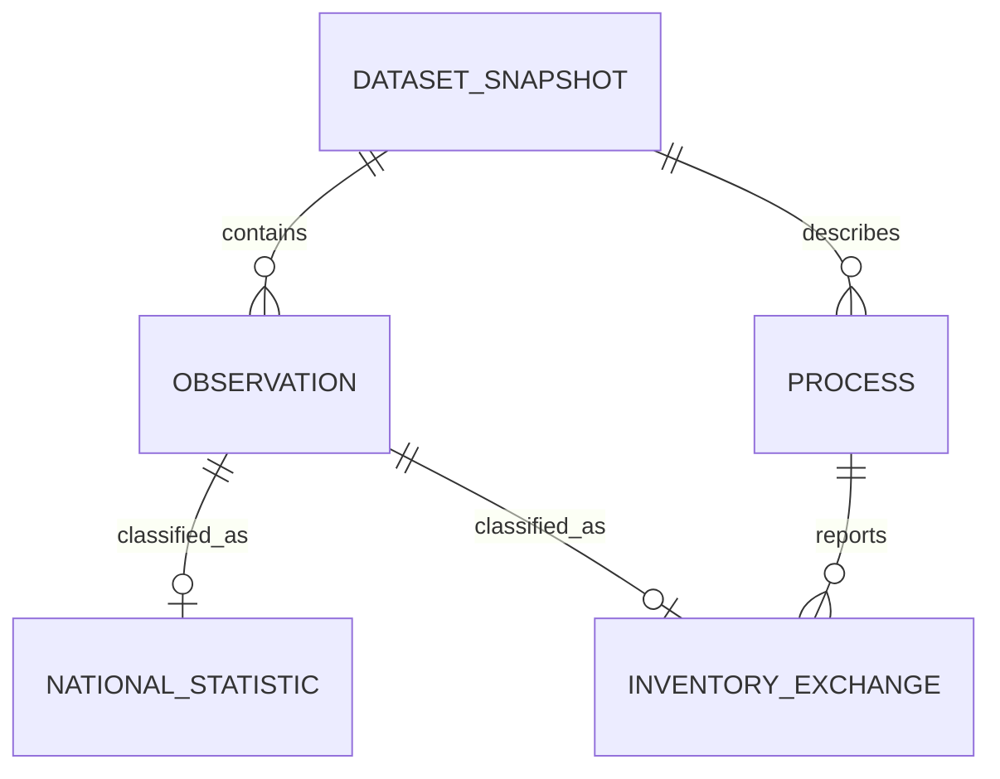

# MySQL สำหรับ NSO และ inventory งานวิจัย

คำสั่ง: `python -X utf8 scripts/load_supplemental_mysql.py`

ใช้ container และ volume ที่ตรวจ ownership ของ workspace แล้ว ต้องเปิด Docker Desktop ก่อน สคริปต์ไม่ลบข้อมูลเดิม เก็บแต่ละ report เป็น snapshot ตาม SHA256 และตรวจค่าที่อ่านกลับทุกแถว รวม payload ทั้งหมดและคอลัมน์เชิงสัมพันธ์ ข้อมูลจำนวนลบของ NSO net supply ยังคงได้ตามนิยามต้นทาง

## โครงสร้าง

- `dataset_snapshot`: hash ของ report JSON, ชนิดข้อมูลและ path ของ artifact
- `observation`: identity ภายใน snapshot, DECIMAL(30,12), หน่วย, สถานะ และ payload ต้นทางครบ
- `national_statistic`: ตาราง ปี รายการ หน่วยงานต้นทางอยู่ใน payload และ locator CSV/hash
- `process`: FAME/H-FAME พร้อมฐาน 1000 MJ fuel ภูมิศาสตร์ และระดับเทคโนโลยี
- `inventory_exchange`: flow, input/output, role, data period ที่ยัง null ตามหลักฐาน และ locator ตารางวิจัย

PK เป็นคู่ snapshot/observation และ FK ป้องกันแถวที่ไม่มี parent; `process` มี PK snapshot/process เพื่อไม่เชื่อมข้อมูลข้ามรุ่น ข้อมูลเดิมคงไว้เมื่อเกิด snapshot ใหม่ การอ่านต้องกรอง snapshot_id จาก evidence ห้ามนับทุกรุ่นรวมกัน

MySQL เป็นสำเนาเชิงสัมพันธ์จาก artifacts ที่สร้างแล้ว เว็บยังอ่าน SQLite/JSON ไม่ได้เปลี่ยน backend ในงานนี้

การโหลดไม่เปลี่ยน NSO เป็น ACCEPTED_REFERENCE และไม่เปลี่ยนงานวิจัยเป็น full accepted LCI ไม่เปลี่ยนสิทธิแจกจ่าย ผลการรันจริงเมื่อสำเร็จอยู่ `evidence/supplemental-mysql.json`; การมี source code อย่างเดียวไม่ยืนยันว่าโหลดสำเร็จ

## ผลตรวจจริง 23 ตุลาคม 2569

โหลดสำเร็จในฐาน tamsood_supplemental: NSO 273 และ product inventory 16 แถว ตรวจจำนวน ค่า Decimal หน่วย สถานะ payload ทุก field และคอลัมน์ subtype ครบ รวมฐานอ้างอิงของ process; ทดสอบ FK และ direction CHECK แล้วปฏิเสธตามคาด หลักฐานอยู่ evidence/supplemental-mysql.json
