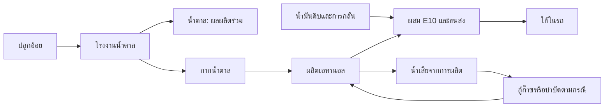

# กรณีศึกษาเอทานอลไทยจากฉบับเต็มที่ผู้ใช้ดาวน์โหลด — 6 พฤศจิกายน 2026

## ข้อเสนอสำหรับเดโม
เลือก **เอทานอลกากน้ำตาลไทย / E10 ปี2008** เป็นตัวอย่างงานศึกษาทั้งสายตามขอบเขตผู้วิจัย เพราะมีFUเดียว ผังระบบเชื่อมถึงการใช้เชื้อเพลิง การขนส่ง การแบ่งภาระผลผลิตร่วม และทางเลือกจัดการน้ำเสียในเอกสารเดียว ไม่ใช่การนำคนละโรงงาน/ปีมาต่อให้ดูครบ

ใช้คำว่า **กรณีศึกษาวัฏจักรชีวิตเชื้อเพลิงไทยจากงานวิจัย** ยังไม่ใช้คำว่าฐานLCIครบทุกelementaryflowของเรา: ตาราง2เป็นวิธีรวบรวมLCI ไม่ใช่ตารางปริมาณทุกflow ส่วนตาราง5เป็นผลLCIA แหล่งbackgroundมีGREET/IPCCและต่างประเทศ สิทธิrawยังNOT_CLEARED

ตาราง 3 ของงานเดียวกันรายงานค่าเริ่มต้นสำหรับการประมาณ CH₄ จาก anaerobic pond เท่ากับ 0.22 kg CH₄/kg BOD (PDF หน้า 5 / หน้าพิมพ์ 305) โดยระบุแนวทางอ้างอิง Nguyen et al. 2007, AGO 2003 และ IPCC 2000 นี่เป็น default parameter ของวิธีประเมิน ไม่ใช่ค่ามีเทนที่วัดได้จากโรงงาน และยังคำนวณการปล่อยของ TSM ไม่ได้หากไม่มี BOD load และข้อมูลระบบ/ช่วงเวลาของ TSM ที่ตรงกัน

## ไฟล์จริงและผลตรวจ
- กากน้ำตาล DOI10.1007/s11367-008-0011-2:11หน้า557359bytes SHA256fa0c483a9c27fcff84a21668795bf5a6c4ea7f5bc8d52e62b06168b19be51dba
- มันสำปะหลัง DOI10.1065/lca2007.06.343:8หน้า685577bytes SHA256fc6c6439d5255efd92632be392160d4ac74db6590397cf5a548cf2f3a5a67762
- สำเนาprivateในdata/raw/thai-molasses-ethanol-2008และthai-cassava-ethanol-2008 พร้อมmanifest ไม่มีการส่งrawขึ้นเว็บ
- อ่านข้อความทุกหน้าเพื่อscreen;ตรวจภาพกากน้ำตาลPDF3และมันสำปะหลังPDF3–4;สองextractorsตรวจครบทุกfieldของtransportsubset3rows ไม่อ้างตรวจทุกcellของทุกตารางแล้ว

## บทเดโมที่นำไปเล่าได้
1. **หน้าที่และหน่วยอ้างอิง:** เปรียบเทียบการเดินทางด้วยเชื้อเพลิงบนฐาน1litregasoline-equivalent ตามผู้วิจัย ไม่ใช่1litreE100และไม่ใช่1000MJของB100เดิม
2. **วัตถุดิบ:** อ้อยเข้าโรงงานน้ำตาล ได้ทั้งน้ำตาลและกากน้ำตาล กากน้ำตาลจึงไม่ได้ไม่มีภาระโดยอัตโนมัติ
3. **การแบ่งภาระ:** งานใช้economicallocation89.6%ให้น้ำตาล/10.4%ให้กากน้ำตาลในกรณีที่ระบุ ไม่ใช้สูตรนี้กับB100หรือปีปัจจุบัน
4. **ผลิตเชื้อเพลิงและของเสีย:** กรณีฐานกู้ก๊าซจากspentwash12% ส่วน88%เข้าบ่อanaerobic;กรณีทางเลือกเพิ่มการกู้ก๊าซและเปลี่ยนเชื้อเพลิงกระบวนการ ไม่แปลงสัดส่วนนี้เป็นkgCH4โดยไม่มีBODloadและสูตร
5. **ขนส่ง/ผสม/ใช้:** ethanolกับgasolineรวมเป็นE10แล้วเผาไหม้ในรถ ต้องคิดส่วนgasolineด้วย ไม่อ้างเฉพาะฝั่งethanolเป็นทั้งE10
6. **สรุปผลและข้อจำกัด:** แยกphysicalinventoryออกจากผลkgCO2eq;biogenicCO2netzeroเป็นวิธีของงาน ไม่ลบCH4/N2Oทิ้ง;เป็นกรณีอดีต ไม่ใช่ค่าเฉลี่ยไทย2026

ผังนี้วาดใหม่เพื่ออธิบายขอบเขต ไม่ใช่networkเชิงปริมาณหรือการยืนยันว่าตรวจbackgroundครบแล้ว

## ตัวอย่างเสริมจากมันสำปะหลัง
Table3/PDF4printed150มีเส้นทางโรงมัน→โรงเอทานอล→โรงกลั่น→ปั๊ม พร้อมรถดีเซล ช่วงcapacityและระยะทางสมมติของงาน ตรวจทุกfieldของ3rowsด้วยpdfplumber+pypdf+ภาพ ไม่รับเป็นเส้นทางB100จริงหรือระยะปัจจุบัน รายการอยู่ในevidence/thai-ethanol-2008-review.json

## ข้อผิดพลาดต้นฉบับที่ต้องรักษา
Table4/PDF4printed150ของมันสำปะหลัง:acidificationCG3.00/E10-b3.07แต่percentchange−6.8;การอ่านภาพยืนยันตัวเลขนี้จริง คำนวณจากค่าที่แสดงจะเพิ่มประมาณ2.33% จึงพักแถวนี้ ไม่เปลี่ยน3.00เป็นค่าอื่นหรือแก้เปอร์เซ็นต์ให้ตรงเอง ผลกระทบแถวอื่นต้องตรวจรายแถวก่อนนำเข้า

## ขั้นต่อไปที่ทำได้
ทำpresentation/publicreferencepreviewด้วยข้อความสรุปและลิงก์DOIได้ ส่วนการนำเข้าปริมาณต้องจัดทำinventoryที่แยกreported/derived/assumption,providerและmethodทุกตัวก่อน ยังไม่มีfullmachine-readableLCIจากสองPDFนี้ล้วนๆ การตรวจนี้ไม่แก้productionmodelหรือผลCO2eรวมเดิม

คำสั่งตรวจsubset: `python scripts/review_thai_ethanol_2008.py`
